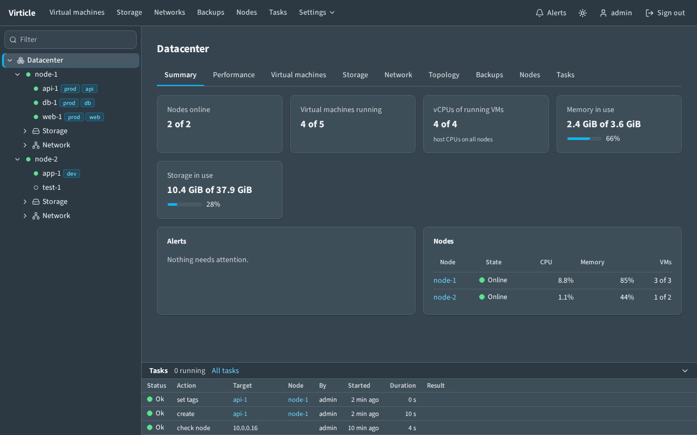
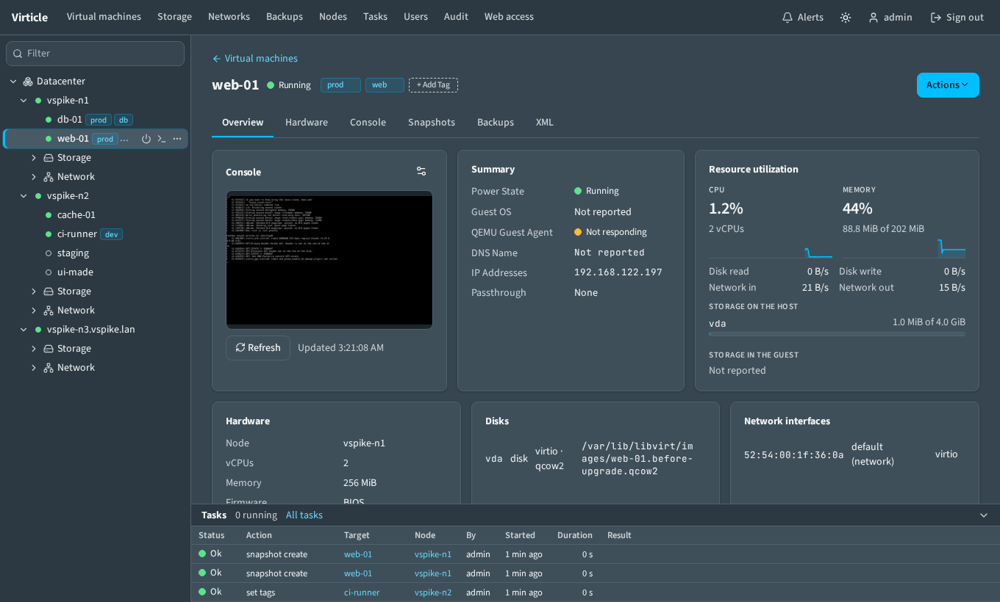
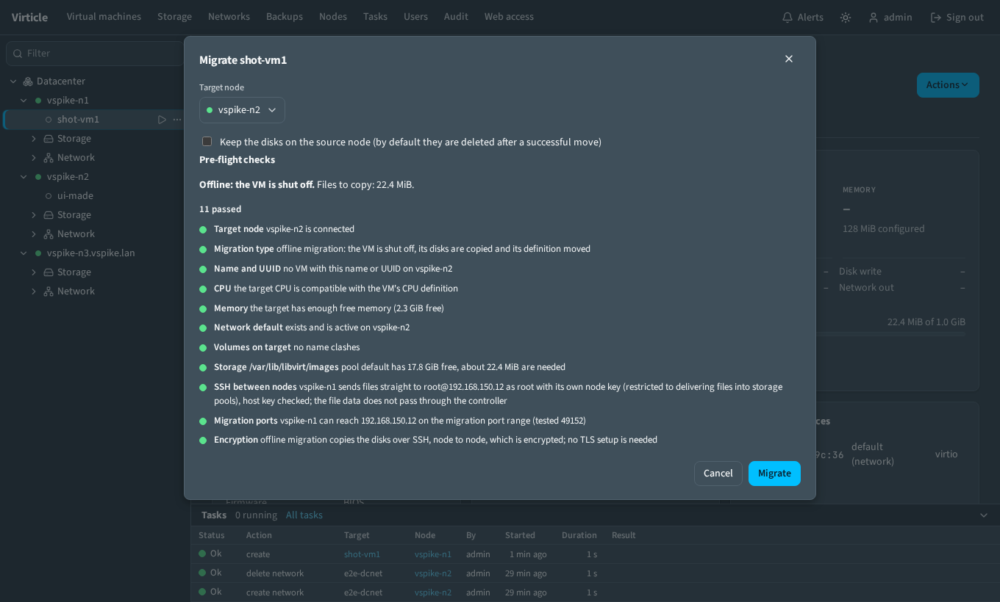

# Virticle

A web UI for KVM/QEMU/libvirt hosts. One Go binary with the UI embedded; it
manages hosts ("nodes") over SSH and runs no agent on them.

- **VMs**: create from cloud images, ISOs or templates; clone; cloud-init;
  UEFI, Secure Boot, vTPM; hot-plug hardware; edit the libvirt XML.
- **Consoles**: VNC and serial, in the browser.
- **Migration**: live and offline between nodes, with pre-flight checks;
  node maintenance and evacuation.
- **Snapshots and backups**: manual or scheduled, with retention; restore,
  export, import.
- **Storage and networks**: pools, volumes, uploads, image catalogue; NAT and
  bridged networks, DHCP reservations.
- **Passthrough**: PCI devices and GPUs.
- **Access**: users with three roles, API tokens, audit log, task log, alerts.
- **HTTPS**: self-signed, your own certificate, ACME, or behind a reverse proxy.

Libvirt stays the source of truth: VMs made with `virsh` and VMs made here look
the same.

## Quick start

### 1. Install the controller

Pick one. Any Linux amd64 machine that can reach the nodes over SSH will do.

- **Package** (systemd service on `127.0.0.1:8080`). Download from
  [Releases](https://github.com/jroeder5597/virticle/releases), then:

      sudo apt-get install ./virticle_<version>_amd64.deb     # Debian, Ubuntu
      sudo dnf install ./virticle-<version>-1.x86_64.rpm      # RHEL family
      sudo systemctl enable --now virticle

- **Container** (HTTPS with a self-signed certificate on `127.0.0.1:8080`):

      docker compose up -d --build

- **From source** (needs Go and Node.js):

      make build
      ./bin/virticle -data ./data

### 2. Create the administrator

Open `http://127.0.0.1:8080` (`https://` for the container). The first visit
asks for the administrator account. The password needs at least 10 characters.

### 3. Add a node

A node is a Linux host with hardware virtualisation. Tested: Debian 13 and
Rocky Linux 10.

1. Open **Nodes > Add node**.
2. Choose **Prepare this node** and give an administrator login for the host.
   It is used once and not stored. Prepare then:
   - checks the host (CPU flags, `/dev/kvm`, disk space, time sync),
   - installs libvirt and QEMU,
   - installs the node command (`virticle-node`), the one program the
     controller runs as root on the node,
   - creates the service account `virticle` with a restricted SSH key and a
     sudo rule that allows the node command and nothing else (with the root
     option there is no account: the controller signs in as root),
   - tests the connection.
3. Save the node.

The same from a shell: `virticle node prepare admin@host` (`--check` changes
nothing). A node must be prepared before it is added. A host that already
runs libvirt is prepared the same way; its networks, pools and VMs stay.

### 4. Create a VM

1. **Storage**: select a pool, open **Image catalogue** and download a cloud
   image.
2. **Virtual machines > New VM**: name, node, **Disk image**, CPU, memory,
   network.
3. Open the VM and use the **Console** tab.

## Everyday use

- **Tree on the left**: nodes and their VMs. Drag its edge to resize.
- **Tasks panel at the bottom**: every action with progress and result. Long
  actions run in the background.
- **Status**: a green, yellow or red dot with the word Ok, Warning or Error.
- **Migrate**: **Actions > Migrate**. The pre-flight list says what blocks it.

  

- **Remote access**: **Web access** (admin) switches to HTTPS or a reverse
  proxy without a restart. An unconfirmed change reverts after 60 seconds.

Live migration is coordinated by the controller. When a migration or a restore
has to copy files, they go from node to node over a restricted node key that
the controller sets up itself; the pre-flight check shows whether it works.

## Documentation

| Topic | File |
| --- | --- |
| Using the UI, with screenshots; troubleshooting | [docs/user-guide.md](docs/user-guide.md) |
| Install, upgrade, rollback, uninstall | [docs/install.md](docs/install.md) |
| Preparing a node, the node command, manual steps | [docs/install-node.md](docs/install-node.md) |
| HTTPS, ACME, reverse proxies | [docs/web-tls.md](docs/web-tls.md) |
| Flags, roles, API tokens, data, schedules, backup format, limits | [docs/reference.md](docs/reference.md) |
| Building, tests, releases | [docs/development.md](docs/development.md) |
| What is done, untested and open | [ROADMAP.md](ROADMAP.md) |

## Contributing and security

- Bugs and ideas: open an issue. Code: see [CONTRIBUTING.md](CONTRIBUTING.md).
- Vulnerabilities: report privately, see [SECURITY.md](SECURITY.md).

## Status

Early release. Tested with a controller on Linux amd64 and nodes on Debian 13
and Rocky Linux 10.

## Licence

[Apache License 2.0](LICENSE). Third-party notices are in [NOTICE](NOTICE).
