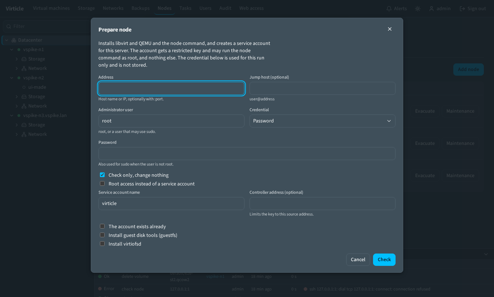

# Preparing a node

A node is a Linux host with libvirt and QEMU that the controller reaches over SSH. No Virticle service runs on it.

**Prepare a node before you add it.** Either way works:

- In the web UI: **Nodes > Add node**.
- In a shell: `virticle node prepare admin@host`.

This page tells you what prepare does, so you can check it or do the same by hand. The last part,
[Reference: the node command](#reference-the-node-command), is for readers who audit the program that runs as root.

On this page:

- [The two ways to reach a node](#the-two-ways-to-reach-a-node)
- [The controller host as a node](#the-controller-host-as-a-node)
- [What prepare does](#what-prepare-does)
- [Prepare options](#prepare-options)
- [Upgrade and unprepare](#upgrade-and-unprepare)
- [Tested systems and packages](#tested-systems-and-packages)
- [Preparing by hand](#preparing-by-hand)
- [The restricted SSH key](#the-restricted-ssh-key)
- [How nodes exchange files](#how-nodes-exchange-files)
- [What the node command is used for](#what-the-node-command-is-used-for)
- [How the controller finds the access](#how-the-controller-finds-the-access)
- [Reference: the node command](#reference-the-node-command)

## The two ways to reach a node

Both use the same program, **the node command** (`virticle-node`). Prepare installs it at
`/usr/local/libexec/virticle-node`. The controller starts it over SSH when something must be done as root. It exits when
it is done.

| Access | The controller signs in as | The node command runs | Choose it |
| --- | --- | --- | --- |
| **Service account** | `virticle-node`, a user without a password | As root, through one sudo rule that allows this program and nothing else | By default. Recommended. |
| **Root** | `root` | Directly | When you do not want an extra account: `virticle node prepare --root` |

There is no other way. A login that has general passwordless sudo but no node command is not prepared.

## The controller host as a node

The machine that runs the controller can also be a node. Prepare it like any other host, with its own address. The two
accounts on that machine are separate:

| Account | Made by | Used for |
| --- | --- | --- |
| `virticle` | The controller package | Runs the controller service. Home `/var/lib/virticle`, no login shell. Prepare never changes it. |
| `virticle-node` | `virticle node prepare` | What the controller signs in as on a node. Home `/var/lib/virticle-node`, login shell `/bin/sh`, restricted key, one sudo rule. |

## What prepare does



Prepare signs in with an **administrator credential that you give for this one run**.

- With the command line, use your SSH agent, or `--identity FILE`, or a password on standard input.
- In the web dialog, enter a password or paste a private key without a passphrase. Choose **Check** to see what would
  change, then **Add node** (**Prepare node** for a node that is already added); the dialog keeps the credential in memory for that, so you do not type it twice. The password is also used for sudo
  when the user is not root.

The credential is used in memory only. It is not stored, not logged, and not written to the audit log or the task
record. It is separate from the controller's own key.

Prepare runs these steps in order:

1. **Checks the host.** This part only reads. `--check`, or the **Check** button in the dialog, stops here. It looks at:
   - CPU virtualisation flags (`vmx` or `svm`) and `/dev/kvm`
   - nested virtualisation (information, when the host is itself a VM)
   - IOMMU on or off (information, needed for device passthrough)
   - distribution and version against the tested list, and the architecture
   - free space under `/var/lib/libvirt/images`
   - SELinux or AppArmor, and time sync
   - whether libvirt is installed, and its version
   - whether another controller runs snapshot schedules there
   - how many VMs exist (existing VMs are left alone)

   Prepare never reboots the host. If a reboot or kernel parameter is needed (for IOMMU), a row says so.
2. **Installs packages** (see the lists below, including the guest disk tools) and enables libvirt. It starts the `default` network and defines the
   `default` pool when they are missing. Existing networks and pools are not changed.
   **Opens the migration ports in the firewall.** When firewalld is active, it defines the service `virticle-node`
   (TCP `49152` to `49215`) and adds it to the default zone, permanent and running. When ufw is active, it adds
   `ufw allow 49152:49215/tcp comment 'virticle-node'`. With no firewall nothing happens. With nftables or iptables
   rules and no firewalld or ufw, a row lists the ports for you to open. SSH rules are never touched. If a firewall
   command fails, the row is a warning with the commands to run yourself, and prepare goes on.
3. **Service account only: sets up the account.** Default name `virticle-node`, a system user, home
   `/var/lib/virticle-node`, shell `/bin/sh`, no password, in the groups `libvirt` and `kvm`. It asks nothing:
   - No such account: it is created.
   - The account exists and prepare made it: prepare checks the groups, the shell and the home directory and repairs
     what is wrong. Nothing to repair means nothing changes.
   - An account of that name exists and prepare did not make it: prepare stops with a message. Use another name
     (`--user OTHERNAME`), or `--use-existing-user` if you manage that account yourself.
   - A node prepared by 0.2.0 has the account `virticle` with the comment "virticle service account". Prepare keeps
     using it, so no second account appears.
4. **Installs the controller's public key** for that account (or for root) with restrictions. It also installs the node
   command and, for a Service account, the sudo rule.
5. **Creates the node key** of the account. Nodes use it to copy files to each other (see
   [How nodes exchange files](#how-nodes-exchange-files)).
6. **Tests the connection** with the same steps as **Test connection** on the node page.

Running prepare again changes nothing and says so.

What is on the node afterwards:

| Item | Where | Service account | Root |
| --- | --- | --- | --- |
| Account | `virticle-node`, comment "virticle service account" | Created | None (root is used) |
| Controller's key | `~/.ssh/authorized_keys` of the account, with restrictions | Yes | Yes |
| Sudo rule | `/etc/sudoers.d/virticle`: the account may run the node command as root | Yes | No |
| Node command | `/usr/local/libexec/virticle-node`, `root:root 0755` | Yes | Yes |
| Node key | `~/.ssh/virticle_peer_ed25519`, the account's own key for copies between nodes | Yes | Yes |

The sudoers file names one account, so a host has one Service account. Preparing it for another account replaces the
rule.

## Prepare options

```
virticle node prepare [--check] [--minimal] [--root] [--user NAME] [--use-existing-user[=NAME]] [--confirm]
                      [--from ADDR] [--take-over] [--jump user@host]
                      [--identity FILE] [--password-stdin] [--data DIR] [user@]host[:port]
```

| Option | Meaning |
| --- | --- |
| `--check` | Look and report. Change nothing. |
| `--root` | Root access. The controller signs in as root and no account is created. The node command is installed all the same, and the controller runs it directly, without sudo. Prepare shows a warning ("The controller will sign in as root. A service account is safer"). |
| `--minimal` | Leave out the guest disk tools. Clone with sysprep then needs a sealed template. |
| `--user NAME` | Name of the Service account (default `virticle-node`). |
| `--use-existing-user NAME` | For an account you manage yourself. Prepare reports what is missing (groups, login shell, sudo rule). It changes nothing about the account except adding the controller's key. With `--confirm` it also adds the groups and the sudo rule. The account needs a login shell such as `/bin/sh`. |
| `--confirm` | Only with `--use-existing-user`: add the groups and the sudo rule. |
| `--from ADDR` | Adds `from="ADDR"` to the key, so it works only from the controller's address. |
| `--take-over` | The node trusts another Virticle controller's key (prepare then stops and asks): remove that key. See [controller-backup.md](controller-backup.md#c-there-is-no-backup-and-the-controller-is-lost). |
| `--jump user@host` | Reaches the node through a jump host. |
| `--identity FILE`, `--password-stdin` | How you sign in as administrator (default: your SSH agent). |
| `--data DIR` | The controller's data directory (its key, `known_hosts`, instance id). Default `data`. |

The web dialog has no options except **Root access instead of a service account**. The other options are for the
command line. `virticle node unprepare` takes `--user`, `--root`, `--jump`, `--identity`, `--password-stdin` and
`--data`.

The host key of the node is recorded in the controller's `known_hosts` the first time it is seen.

## Upgrade and unprepare

**Upgrade.** When the controller says that a node was "prepared by an older version", run prepare again. This happens
when the node command there reports another protocol version, or is still the old shell script from 0.1.0. Prepare
replaces the node command and removes the old script. Steps for 0.1.0 are in
[install.md](install.md#upgrading-from-010).

**Nodes prepared by 0.2.0.** They have the account `virticle` (made by prepare, with the comment "virticle service
account"). Preparing them again keeps that account. It does not make `virticle-node`.

**Unprepare.** `virticle node unprepare admin@host` removes the account, key, node command, sudo rule and the
firewall service `virticle-node` (or the ufw rule with that comment). It leaves packages, VMs, pools and networks alone.

- Without `--user` it removes the account that prepare made: `virticle-node`, or `virticle` on a node that 0.2.0
  prepared.
- It removes an account only when prepare created it (the account carries the comment "virticle service account"). For
  any other account it removes just the key and the rule. The group memberships stay. The controller package's account
  `virticle` has no such comment and is never removed.
- It ends the account's processes first, so remove the node in the controller before you run it.

## Tested systems and packages

| Distribution | Status |
| --- | --- |
| Debian 13, Rocky Linux 10 | Tested |
| Debian 12, Ubuntu 22.04 and 24.04, RHEL, AlmaLinux and Rocky 9 and 10, Fedora | Untested. Prepare warns and goes on. |
| Anything else | Error. Install by hand (below, including the node command), then add the node. |

Package names, checked on Debian 13 and Rocky Linux 10:

| | Debian family | RHEL family |
| --- | --- | --- |
| Base | `qemu-system-x86 qemu-utils libvirt-daemon-system libvirt-clients dnsmasq-base ovmf swtpm swtpm-tools sudo curl ca-certificates openssh-client` | `qemu-kvm libvirt virt-install edk2-ovmf swtpm swtpm-tools sudo curl openssh-clients` |
| Guest disk tools (left out by `--minimal`) | `libguestfs-tools` | `guestfs-tools` |

The guest disk tools provide `virt-sysprep`, which **clone with sysprep** uses. `virtiofsd` is not installed; nothing
in Virticle uses it.

## Preparing by hand

If you cannot use `virticle node prepare`, do the same steps yourself. Run these as root on the node. Debian family:

```sh
apt-get update
apt-get install -y --no-install-recommends qemu-system-x86 qemu-utils libvirt-daemon-system libvirt-clients \
    dnsmasq-base ovmf swtpm swtpm-tools sudo curl ca-certificates openssh-client libguestfs-tools
systemctl enable --now libvirtd
```

RHEL family (libvirt runs as modular daemons there; prepare enables the sockets):

```sh
dnf install -y qemu-kvm libvirt virt-install edk2-ovmf swtpm swtpm-tools sudo curl openssh-clients guestfs-tools
systemctl enable --now virtqemud.socket virtnetworkd.socket virtstoraged.socket virtnodedevd.socket \
    virtsecretd.socket virtproxyd.socket virtlogd.socket
```

Then, on both:

```sh
virsh -c qemu:///system net-start default || true         # define it first if the host has none
virsh -c qemu:///system pool-define-as default dir --target /var/lib/libvirt/images
virsh -c qemu:///system pool-build default; virsh -c qemu:///system pool-autostart default; virsh -c qemu:///system pool-start default

useradd --system --create-home --home-dir /var/lib/virticle-node --shell /bin/sh --user-group \
    --comment 'virticle service account' -p '*' virticle-node
usermod -aG libvirt,kvm virticle-node
install -d -m 700 -o virticle-node -g virticle-node /var/lib/virticle-node/.ssh
echo 'restrict,pty,port-forwarding ssh-ed25519 AAAA... virticle-controller' > /var/lib/virticle-node/.ssh/authorized_keys
chown virticle-node:virticle-node /var/lib/virticle-node/.ssh/authorized_keys; chmod 600 /var/lib/virticle-node/.ssh/authorized_keys
runuser -u virticle-node -- ssh-keygen -q -t ed25519 -N '' -C virticle-peer@$(hostname) -f /var/lib/virticle-node/.ssh/virticle_peer_ed25519

install -d -m 755 /usr/local/libexec
install -m 755 -o root -g root virticle-node /usr/local/libexec/virticle-node   # see below
printf '%s\n' 'virticle-node ALL=(root) NOPASSWD: /usr/local/libexec/virticle-node' > /etc/sudoers.d/virticle.new
visudo -cf /etc/sudoers.d/virticle.new && install -m 440 -o root -g root /etc/sudoers.d/virticle.new /etc/sudoers.d/virticle
rm -f /etc/sudoers.d/virticle.new
```

For Root access leave out the account and the sudo rule: put the controller's key into root's `authorized_keys`, install
the node command the same way, and create the node key as root.

On SELinux hosts run `restorecon -R /var/lib/virticle-node/.ssh` and `restorecon /usr/local/libexec/virticle-node`
afterwards. The `virticle-node` file is embedded in the controller binary (linux/amd64 and linux/arm64) and
`virticle node prepare` installs it. To get it by hand, build it from the source with `make nodebin`. The files are
`internal/nodebin/dist/virticle-node_linux_amd64` and `_arm64`.

## The restricted SSH key

The key line is `restrict,pty,port-forwarding[,from="ADDR"] ssh-ed25519 AAAA... virticle-controller`.

- `restrict` turns off everything not named: X11 and agent forwarding, `~/.ssh/rc`, and the terminal.
- `port-forwarding` is required: the controller reaches libvirt by forwarding a connection to its UNIX socket, and the
  VNC console to the VM's display on the node's loopback address.
- `pty` is required: the event stream (`virsh event --loop`) runs with a terminal so that closing the session ends
  the remote process.
- `permitopen=` was tried and dropped: OpenSSH applies it to the UNIX socket forward too, so libvirt becomes unreachable.
- Shell commands, `scp` and `sftp` keep working (they are not restricted by `restrict`).

## How nodes exchange files

Any two nodes can exchange files, for example when a migration copies local disks or a backup is restored on another
node. A Service account node and a Root node can do this with each other.

Each node has its own SSH key, the **node key** (`~/.ssh/virticle_peer_ed25519`, made by `virticle node prepare`). The
private half stays on the node. You set up nothing by hand. When a file has to be copied, the controller:

1. Installs the sending node's public key on the receiving node as
   `restrict,command="sudo -n /usr/local/libexec/virticle-node peer-recv"` (without `sudo -n` when the receiving
   account is root). That key can deliver one new file into a storage pool and nothing else.
2. Records the receiving node's SSH host key, taken from the controller's `known_hosts`, on the sending node. The
   sending node checks it strictly.
3. Tests the path with `peer-ping`. Then it runs `peer-send` on the source, which reads the file as root and streams it
   over `ssh` to `peer-recv` on the target.

Facts:

- The file data goes from node to node. It does not pass through the controller.
- The migration pre-flight does these steps in its **SSH between nodes** row. It repeats safely.
- Removing a node from the controller removes its key from the other nodes, and theirs from it.
  `virticle node unprepare` removes the node's key and the keys of peers installed on it.
- **Live migration** is coordinated by the controller for every node. It calls the phases of libvirt's migration
  protocol on both nodes, so it needs no SSH between the nodes. The memory stream and the disk mirror still go from node
  to node.

## What the node command is used for

The account is in the `libvirt` group, so libvirt operations and volume upload need no root. The node command is used
for:

- **encrypted migration** certificates,
- **migrating VMs**, live and offline,
- **backing up and restoring VMs**, on the same node or another one, including export and import,
- **downloading** images and the image catalogue into a pool,
- **importing** disks and OVAs,
- **moving a disk** to another pool,
- **host bridges**: Linux bridges with VLAN filtering, with a rollback on the node,
- **cloning with guest preparation** (`virt-sysprep`, from the guest disk tools; not there after `prepare --minimal`).

Backup export and import stream through the controller to and from the browser.

## How the controller finds the access

- The controller never replaces the node command by itself. When the version on a node differs from the controller's,
  **Test connection** says "prepared by an older version; run `virticle node prepare` again" (or names the two
  versions). The node counts as not prepared, and the features that need root are off, until an administrator runs
  prepare again.
- On each connection the controller detects the access:

  | Detected | When |
  | --- | --- |
  | **Root** | The user id is 0 and the node command of this version answers. |
  | **Service account** | The node command is present, its version matches, and `sudo -n virticle-node version` works. |
  | **Not prepared** | Anything else. |

  A node stored as `sudo` by an older version is detected again.

## Reference: the node command

This part is for readers who audit what runs as root on a node.

`/usr/local/libexec/virticle-node` is a Go program, `root:root 0755`, embedded in the controller and versioned
(`virticle-node version` prints the protocol number, which the controller compares with its own). The sudo rule of the
Service account allows exactly this program:

```
# /etc/sudoers.d/virticle
virticle-node ALL=(root) NOPASSWD: /usr/local/libexec/virticle-node
```

(On a node that 0.2.0 prepared the account is `virticle`.) sudoers cannot pin the arguments of a program, so the node command checks them itself.

| | |
| --- | --- |
| **What it may do** | Run one of the fixed verbs below. Every verb validates all its arguments first (absolute paths inside the allowed roots, no `..`, no `//`, no shell characters, no symbolic links in written paths). It never passes an argument to a shell. It works on open directory descriptors, so a link swapped in later is not followed. |
| **What it may not do** | There is no verb that runs a given command, none that reads or writes outside the allowed roots, and none that replaces an existing file. It has no listener and no daemon. It cannot update itself: that would let anyone who holds the service account install any code as root. |

### Verbs

| Verb | Does |
|---|---|
| `version` | prints the protocol version |
| `migtls-state DIR` | prints the migration certificate directory (`DIR` must be the one `qemu.conf` names, default `/etc/pki/qemu`) |
| `migtls-mkdir DIR` | creates that directory |
| `migtls-put DIR NAME OWNER MODE` | stdin to `DIR/NAME.virticle-tmp`; `NAME` from the five certificate files and the marker, `MODE` 0400 for keys and 0644 otherwise, `OWNER` `user:0`; at most 64 KiB |
| `migtls-discard DIR` | removes the temporary files |
| `migtls-commit DIR [backup:NAME]... [rm-legacy] [restorecon]` | keeps replaced files as `*.virticle-orig`, moves the temporary files into place |
| `migtls-remove DIR (rm:NAME\|restore:NAME)...` | removes the setup's files, puts backups back |
| `migtls-rmdir DIR TARGET` | removes an empty directory the setup created (`TARGET` is `DIR` or one of its parents below `/etc`) |
| `gpu-users PCIADDR` | names the processes that hold a graphics card open |
| `roots` | prints the allowed roots (see below) |
| `stat PATH...` | `KIND\|BLOCKS\|BLOCKSIZE\|MODE\|SIZE` per path, or `MISSING` |
| `remove PATH...` | removes files (not directories, not symbolic links; a missing file is fine) |
| `rmtree DIR` | removes a work directory (`.virticle-*`) or a directory that holds `manifest.json` |
| `rmdir DIR` | removes an empty directory |
| `move SRC DST` / `copy SRC DST` | rename or copy; `DST` must not exist and is never replaced |
| `read PATH MAXBYTES` | prints a file, at most `MAXBYTES` bytes (up to 64 MiB) |
| `write PATH MAXBYTES [MODE]` | stdin to a new file, at most `MAXBYTES` bytes; `MODE` 600 or 644 |
| `mkworkdir DIR TAG` / `chmod-work MODE DIR` | private work directory `DIR/.virticle-TAG.XXXXXX`; its mode (700 or 711) |
| `qemu-img-info PATH [chain] [FORMAT]` | `qemu-img info` as JSON; every backing file must also be inside a root |
| `disk-boot PATH` | what an existing disk image can start with: reads its first 64 KiB through `qemu-img dd` and prints the partition table kind, whether an EFI System Partition and a BIOS boot partition exist, and whether the first sector has boot code (JSON; nothing is mounted or run) |
| `sha256 PATH` | SHA-256 of a file |
| `tools-missing NAME...` | which of `qemu-img ssh scp tar sha256sum` are missing |
| `df DIR` | free bytes of the file system that holds `DIR` |
| `files-size DIR NAME...` | size of each regular file `DIR/NAME` (plain names, no symbolic link), or `MISSING` |
| `backup-scan DIR MARKER` | the backups in a pool directory with their manifests (at most 500; manifests at most 64 KiB; `MARKER` is `@@@` and 16 hex digits) |
| `tar-pack DIR NAME...` | tar of the named plain files of a backup directory (one that holds `manifest.json`) on stdout |
| `tar-unpack WORKDIR` | stdin tar into the empty work directory; names with a slash are skipped; if anything but plain single-link files results, the directory is emptied and the call fails |
| `convert-start WORKDIR SRC FORMAT` | detached `qemu-img convert` of `SRC` to `WORKDIR/out.part`; `FORMAT` is `raw`, `qcow2`, `vpc`, `vhdx` or `vdi`; a qcow2 backing chain must be inside the roots and may not use an external data file |
| `convert-poll WORKDIR` / `convert-kill WORKDIR` | exit code and progress of that conversion; stop it |
| `convert-finish WORKDIR DEST` | moves `out.part` to the new file `DEST` (never replaces) and drops the state files |
| `download URL DEST [sha256\|sha512 HEX]` | the node fetches an `http://` or `https://` URL into the new file `DEST` (see "Downloads and imports" below) |
| `download-cancel DEST` | stops the running download of `DEST` |
| `image-info PATH` | `qemu-img info` as JSON for an image to import; the format is recognised from the content |
| `realpath file\|dir PATH`, `free-space DIR` | canonical path of an existing file or directory inside a root; free bytes of its file system |
| `tar-list FILE`, `tar-extract FILE WORKDIR NAME...` | list an OVA; extract plain-named members of an archive that holds regular files only into a work directory |
| `import-convert-start WORKDIR SRC`, `import-convert-status WORKDIR`, `import-convert-kill WORKDIR` | run `qemu-img convert` to qcow2 in the background from a work directory, read its progress, stop it |
| `sysprep DISK...` | `virt-sysprep` with a fixed option set on qcow2 or raw images |
| `net-info`, `net-plan`, `net-status` | read only, JSON: the node's network configuration system and its bridges; what a bridge change would do (request on stdin); the pending and recent changes |
| `net-apply`, `net-confirm ID`, `net-rollback [ID]` | create, change or delete a Linux bridge (request on stdin) with a rollback the node owns; keep the change; restore the saved network settings (see "Host bridges" in the reference) |
| `net-run ID` | internal: the part of `net-apply` that runs in a transient systemd unit, so the SSH session may die while the network changes |
| `peer-key`, `peer-allow`, `peer-disallow` | the account's own node key; install or remove a peer's key (restricted to `peer-recv`) |
| `peer-hostkey-set HOST PORT`, `peer-hostkey-unset HOST PORT`, `peer-list` | host keys the node accepts for its peers; what is on record |
| `peer-send HOST PORT USER SRC DST MODE`, `peer-ping HOST PORT USER`, `peer-recv` | send a file to a peer node; test a peer; receive (the forced command of a peer's key) |
| `svc-allow`, `svc-hosts`, `svc-list`, `svc-peerkey` | internal: the node command starts itself again as the service account to edit that account's `~/.ssh` files, so root never follows a link planted there. Not meant to be called by hand. |
| `convert-run`, `import-convert-run` | internal: the detached part of `convert-start` and `import-convert-start` |

**Allowed roots.** The file verbs work only inside the target directories of the libvirt storage pools of type `dir`,
`fs` and `netfs`, and the UEFI NVRAM directory `/var/lib/libvirt/qemu/nvram`. The node command computes them on the node
on every call. A path must be absolute and plain (`A-Za-z0-9._+=,@/-`, at most 200 characters, no `..`, `//` or trailing
`/`); its parent directory is resolved and must be inside a root; verbs that change or remove refuse a final component
that is a symbolic link; verbs that create refuse to replace anything. A pool whose directory is a system place (`/etc`,
`/usr`, `/root`, `/var/lib/libvirt/qemu`, ...) is never a root.

**Downloads and imports.** `download` runs `curl` as root with `-q`, `--proto =http,https` and
`--proto-redir =http,https`, so neither the URL nor a redirect can name a local file or another scheme. The URL must start with
`http://` or `https://`, be at most 2000 characters and contain only `A-Za-z0-9._~:/?#@!$&()*+,;=%-`. The destination must be
a new name (starting with a letter or digit) inside a root. The data goes to `.NAME.part` next to it, which is created
exclusively and never written through a link; with a digest the file is moved to `NAME` only if it matches; any failure,
cancel or signal removes the part file. Import reads an image or OVA that lies inside a root. `image-info` and
`convert-start` choose the format themselves (raw, qcow2, vmdk, vpc, vhdx or vdi) and refuse a qcow2 whose backing chain
leaves the roots and a VMDK whose descriptor names another file. `tar-extract` refuses an archive that contains anything
but regular files with plain names. `sysprep` takes the first-boot script from the node command itself; the caller
supplies only image paths, each inside a root, not a link, qcow2 (backing chain inside the roots) or raw.
