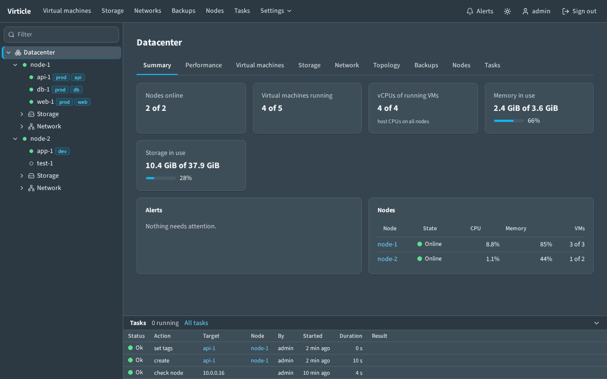
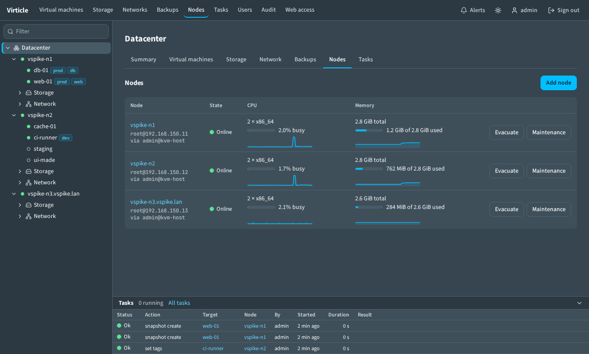
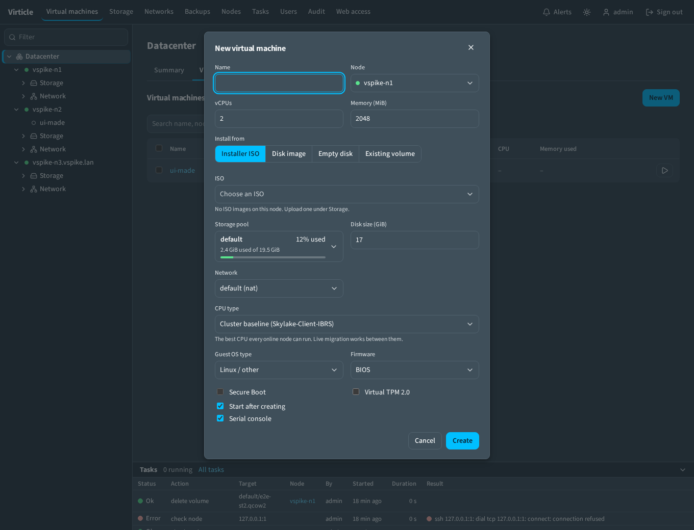
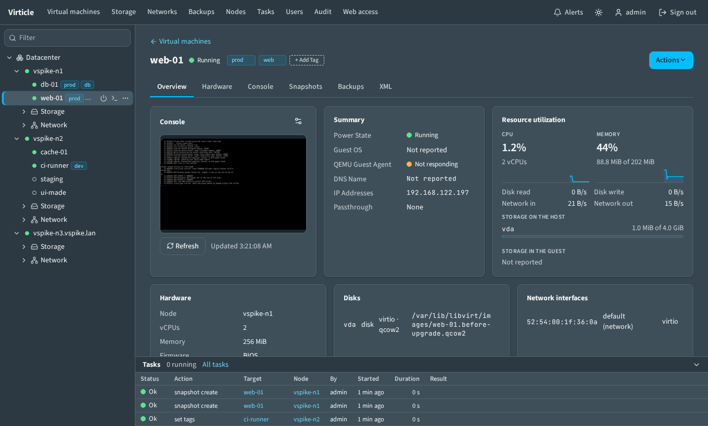
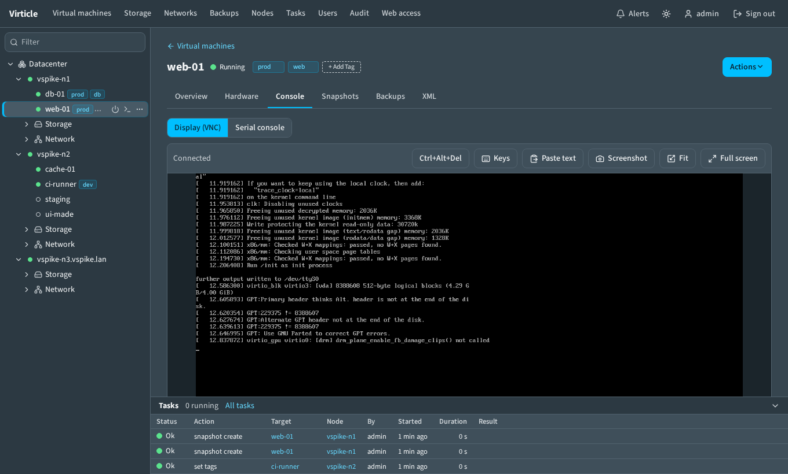
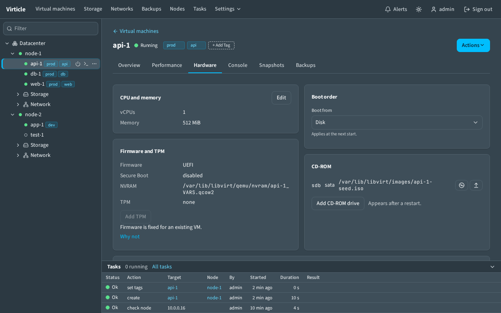
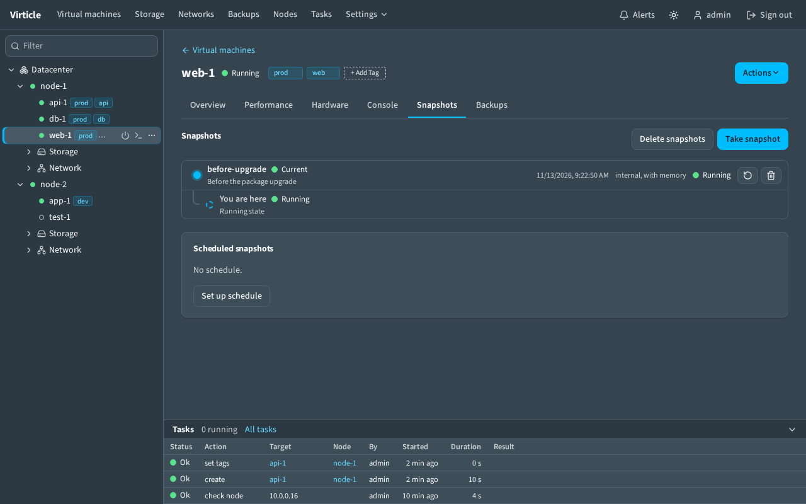
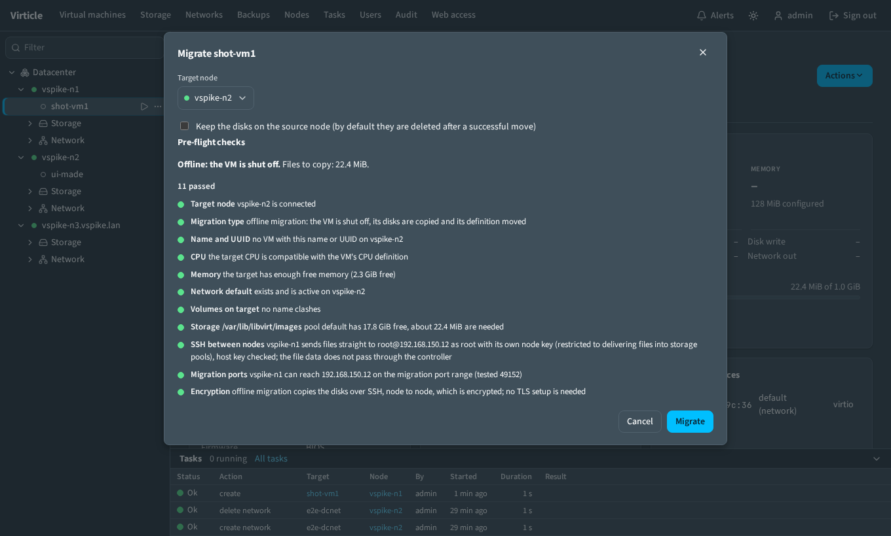
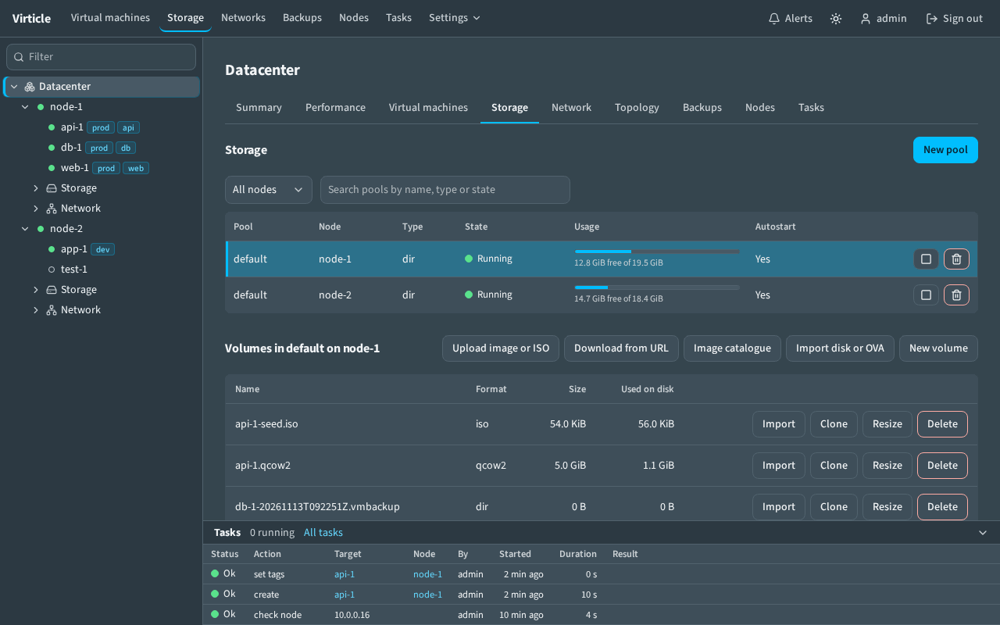
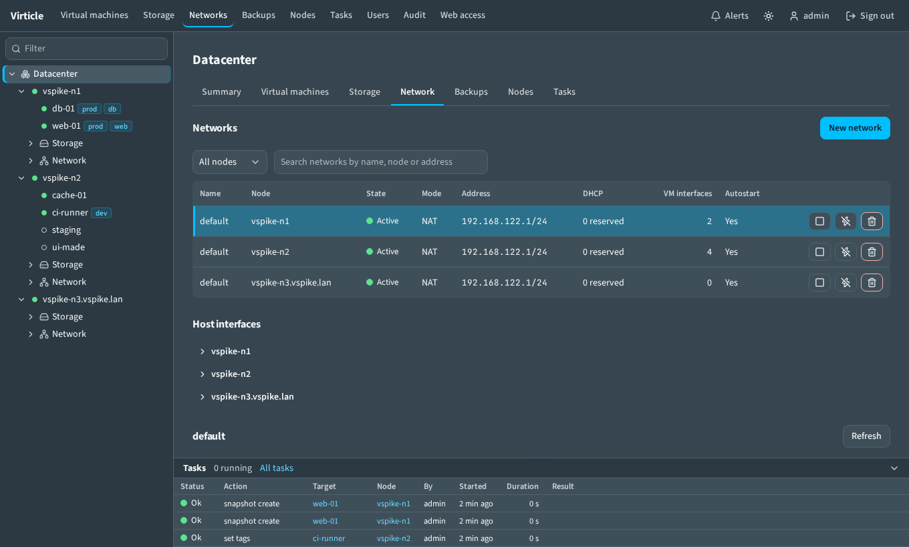

# User guide

How to do the everyday things in the web UI. For installing, see
[install.md](install.md); for adding hosts, [install-node.md](install-node.md).

- [The screen](#the-screen)
- [Nodes](#nodes)
- [Virtual machines](#virtual-machines)
- [Console](#console)
- [Hardware](#hardware)
- [Snapshots](#snapshots)
- [Backups](#backups)
- [Migration](#migration)
- [Storage](#storage)
- [Networks](#networks)
- [Users, tokens and the audit log](#users-tokens-and-the-audit-log)
- [Troubleshooting](#troubleshooting)

## The screen

- **Top bar**: the main pages, alerts, theme, your account.
- **Tree** (left): nodes with their VMs, storage and networks. Type in
  **Filter** to narrow it. Right-click an entry for its actions. Drag the edge
  to resize.
- **Tasks** (bottom): the last actions with progress and result. Running tasks
  stay on top. Drag the top edge to resize, or collapse it with the arrow.
  **All tasks** opens the full log.
- **Status** is always a dot and a word: green Ok, yellow Warning, red Error.

Long actions (snapshots, migration, backups, downloads) run in the background.
You can leave the page; the task keeps going.

## Nodes

- **Add node** registers a prepared host. **Prepare this node** in that dialog
  prepares a fresh host first: it installs libvirt and the node command and
  sets up either a **Service account** (recommended) or **Root** access; see
  [install-node.md](install-node.md). Run prepare again when the controller says
  a node was prepared by an older version.
- Click a node for its summary, VMs, storage, networks, updates and settings.
- **Settings > Test connection** runs each connection step and shows which one
  fails. The **Node access** row says whether the node is reached as a Service
  account, as Root, or is not prepared.
- **Maintenance** stops the node from being chosen as a migration target.
- **Evacuate** live-migrates the node's VMs to the other nodes.

## Virtual machines

### Create

1. **Virtual machines > New VM** (or right-click a node > **Add VM**).
2. Pick what to install from:
   - **Installer ISO**: boots an ISO from a pool. Upload ISOs under Storage.
   - **Disk image**: copies a cloud image. Open **Cloud-init** to set the
     user, password, SSH key and packages.
   - **Empty disk** or **Existing volume**.
3. Leave **CPU type** on **Cluster baseline** unless you need host features.
   It is the best CPU every online node can run, so live migration works.
4. For Windows 11, choose UEFI firmware and tick **Secure Boot** and
   **Virtual TPM 2.0**.
5. **Create**.

### Manage

- The **Overview** tab shows a console preview, state, guest agent, addresses,
  passthrough devices and live usage.
- **Actions** holds everything else:

| Menu | Items |
| --- | --- |
| Power | Start, stop and restart, gracefully or forced. |
| Edit Settings | Name, CPU, memory, and the other Hardware cards. |
| Snapshots | Take, manage, schedule. |
| Clone | Full clone, or a linked clone from a template. |
| Template | Convert to template, seal, convert back. |
| Guest | Sync guest clock. |
| Migrate | To another node, or move a disk to another pool. |
| Delete | Delete the VM; tick the box to delete its disks too. |

- **Tags** sit beside the name. Click **+ Add Tag**; filter by tag in the tree
  and the VM list.
- Guest details (OS, addresses, disk use inside the guest) need the QEMU guest
  agent installed in the VM.

## Console

- **Display (VNC)** is the VM's screen. **Serial console** is a text terminal.
- **Keys** sends combinations the browser would swallow. **Paste text** types
  your clipboard into the guest.
- A VM without a serial console: add one under **Hardware > Serial console**.
- Viewers cannot open a console.

## Hardware

- Each card edits one area: CPU and memory, firmware and TPM, serial console,
  boot order, CD-ROM, clock, disks, network interfaces, passthrough.
- A change that cannot apply to a running VM is saved and marked as applying
  at the next start.
- **Passthrough** lists the host's PCI devices. A device shares its IOMMU
  group with others; the dialog shows what moves together. The host needs
  IOMMU enabled in firmware and on the kernel command line. A graphics card
  that the host itself is using cannot be attached.
- The **XML** tab edits the full libvirt definition.

## Snapshots

- **Take snapshot** runs as a task with a progress bar.
- The tree shows which snapshot the VM is based on (**You are here**).
- The round arrow reverts; the bin deletes.
- **Set up schedule**: interval or daily, keep the newest N.
- A snapshot with memory pauses the guest while memory is saved. A disk-only
  snapshot does not.

## Backups

1. Open the VM's **Backups** tab.
2. **Back up now**: pick the target node and pool. A running VM keeps running.
3. **Restore** a backup as a new VM or over the original.
4. **Save schedule** sets interval or daily runs and how many to keep.

The **Backups** page lists every backup on every node. A backup can be
downloaded as one file and imported on another installation. The format is in
[reference.md](reference.md#backup-format).

## Migration

1. **Actions > Migrate > Migrate to another node**.
2. Pick the target. The pre-flight list checks CPU, memory, networks, storage,
   SSH between the nodes and the migration ports.
3. A red row blocks the move and names the fix. A yellow row is a warning.
4. **Migrate**. With **Live migration** ticked the VM keeps running.

- Disks are copied along; shared storage is not needed.
- The controller coordinates a live migration; the nodes need no SSH between
  them for it. When files have to be copied (disks on local storage, snapshot
  files, a backup restored on another node), they go straight from node to
  node with a node key that the controller installs itself. The key can only
  deliver a new file into a storage pool. The **SSH between nodes** row
  says whether a copy is needed and whether the path works, and **Migration
  ports** whether the target's firewall lets the migration data through.
- To encrypt the streams, set up encrypted migration for both nodes on the
  Nodes page.
- A Debian node and a RHEL-family node cannot exchange VMs.

## Storage

- Select a pool to see its volumes.
- **Image catalogue** downloads common cloud images. **Download from URL** and
  **Upload image or ISO** bring your own.
- **Import disk or OVA** converts foreign disk formats.
- **New pool** adds a directory, NFS, LVM or iSCSI pool. Only directory pools
  are tested.
- Per volume: clone, resize, delete.

## Networks

- **New network** creates a NAT, routed, isolated, open or bridge network.
- Select a network to see its DHCP leases and add address reservations.
- **Host interfaces** lists each node's bridges and NICs.

## Users, tokens and the audit log

- **Users** (admin): add accounts as viewer, operator or admin. See
  [reference.md](reference.md#roles).
- **Account**: change your password, create API tokens.
- **Audit** (admin): every state-changing request, who made it and from where.
- **Web access** (admin): HTTPS and reverse proxy settings. See
  [web-tls.md](web-tls.md).

## Troubleshooting

| Symptom | Check |
| --- | --- |
| Node shows Offline | Node **Settings > Test connection**. It names the failing step. |
| Guest agent "Not responding" | Install and start `qemu-guest-agent` in the VM. |
| Migration blocked | Read the red pre-flight row. Usually a missing network or pool on the target, or a firewall between the nodes (SSH between nodes, Migration ports). |
| Migration or backup refused for a node | **Node access** says Not prepared: the node has no node command, or one from an older version. Run `virticle node prepare` for it again. |
| Locked out after a web access change | Wait 60 seconds for the automatic revert, or run `virticle web reset` and restart. |
| "No ISO images on this node" | Upload one under **Storage**. |
| A task failed | **Tasks** shows the libvirt error in the Result column. |
