# User guide

How to do the everyday things in the web UI. To install, see
[install.md](install.md). To add hosts, see [install-node.md](install-node.md).

- [The screen](#the-screen)
- [Nodes](#nodes): [rolling update](#update-all-nodes-rolling-update)
- [Virtual machines](#virtual-machines)
- [Console](#console)
- [Hardware](#hardware)
- [Snapshots](#snapshots)
- [Backups](#backups): [full and incremental](#full-and-incremental)
- [Replication and failover](#replication-and-failover)
- [Migration](#migration)
- [Storage](#storage): [shared storage (NFS)](#shared-storage-nfs)
- [Networks](#networks): [add a network](#add-a-network), [change a network](#change-a-network), [virtual switches](#virtual-switches)
- [Notifications](#notifications)
- [Performance](#performance)
- [Settings, users and tokens](#settings-users-and-tokens)
- [Troubleshooting](#troubleshooting)

## The screen

- **Top bar**: the main pages (**Virtual machines**, **Storage**, **Networks**, **Backups**, **Nodes**, **Tasks**), the
  **Settings** menu (administrators), alerts, theme, your account. **Backups** lists the backups of VMs;
  **Settings > Controller backup** is the backup of the controller itself.
- **Tree** (left): nodes with their VMs, storage and networks. Type in
  **Filter** to narrow it. Right-click an entry for its actions. Drag the edge
  to resize.
- **Tasks** (bottom): the last actions with progress and result. Running tasks
  stay on top. Drag the top edge to resize, or collapse it with the arrow.
  **All tasks** opens the full log.
- **Status** is always a dot and a word: green Ok, yellow Warning, red Error.

Long actions (snapshots, migration, backups, downloads) run in the background.
You can leave the page; the task keeps going.

## Nodes

A node is a host that runs your VMs.

**This machine as a node.** While there are no nodes, the **Datacenter** page
offers **Set up this machine as a node** when the controller's own machine can
run VMs. SSH must be running on it (`sudo systemctl enable --now sshd`). Choose
the button, enter an administrator login for this machine (used once, not
stored) and choose **Add node**. The node is added when prepare has finished
without errors. The page shows the machine's network address, because other
nodes use that address for migrations; change it if they cannot reach it.

To add another host:

1. Open **Nodes**, then **Add node**.
2. Enter the address and an administrator login. **Add node** installs
   libvirt, QEMU, the guest disk tools and the node command
   (`virticle-node`) if they are missing, sets up the access the controller
   needs, and adds the node. Choose **Check** first to see what would change.
   The only option is **Root access instead of a service account**; leave it
   off unless you want Root. See [install-node.md](install-node.md).
3. For a host that you already prepared in a shell, open **Advanced** and
   choose **Already prepared: connect without an administrator login**. Enter
   its address and SSH user (`virticle-node` for a Service account, `root`
   for Root). A node prepared by version 0.2.0 uses `virticle`. A host that
   another Virticle controller manages makes the check stop with **Take over
   node**: see [controller-backup.md](controller-backup.md#c-there-is-no-backup-and-the-controller-is-lost).

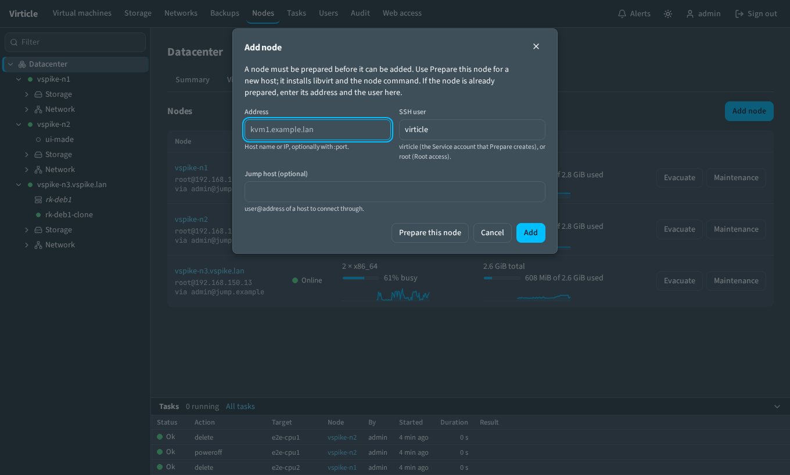

When the node's **Settings** say it was prepared by an older version, choose
**Prepare this node** there (after an upgrade: see [install.md](install.md#upgrading)).

A node has the tabs **Summary**, **Performance**, **Virtual machines**, **Storage**, **Network**,
**Updates** and **Settings**.

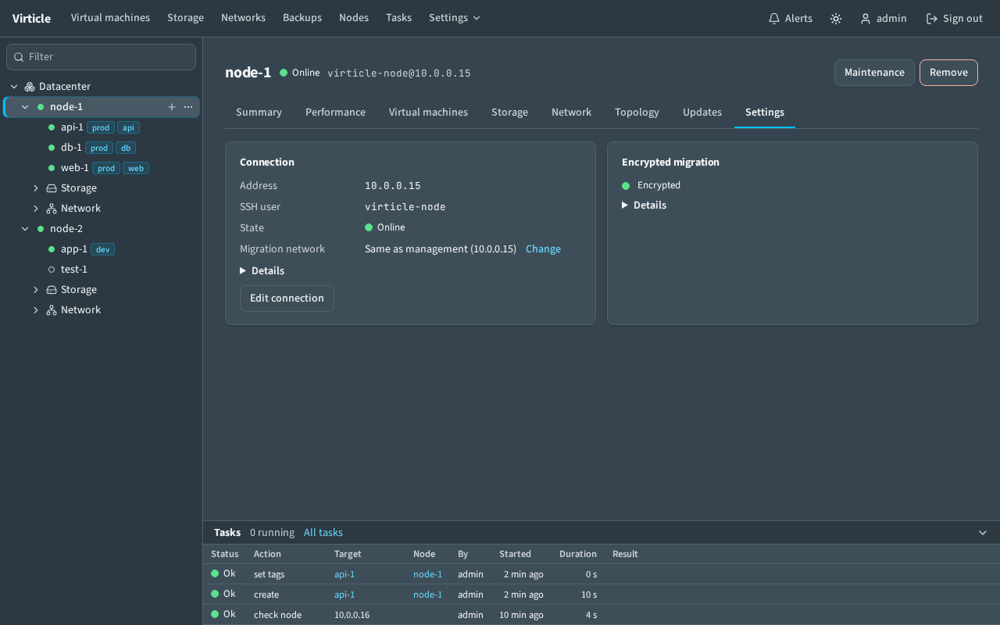

What you can do with a node:

| To do this | Do this |
| --- | --- |
| See a node's summary, VMs, storage, networks, updates and settings | Click the node. |
| Find out why a node is Offline | **Settings > Test connection**. It runs each connection step and shows which one fails. **Settings** warns when the node is not prepared. |
| Keep new migrations away from a node, or empty it | **Maintenance**. The node is never chosen as a migration target. When the node has VMs, tick **Move its virtual machines to other nodes** to live-migrate them away. **Evacuate** appears while a node is in maintenance. |

### Update all nodes (rolling update)

**Nodes > Update all nodes** installs the system updates on every node, one node at a time, and moves the virtual machines
out of the way first. **Update this node** on a node's **Updates** tab does the same for that node alone. Administrators
only.

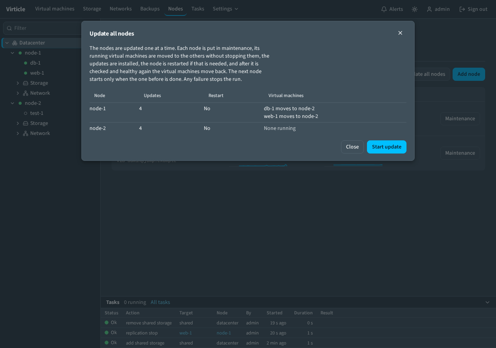

1. Press the button. The plan comes first and nothing has started. It shows, per node, how many updates there are,
   whether the node restarts, and where each running VM moves. A VM that cannot move is listed with the reason: a disk
   that only this node has, a passed-through device, no other node with the same networks, or not enough free memory
   (every other node keeps 5 percent of its memory, at least 512 MiB, free).
2. If some VMs cannot move, choose once:
   - **Shut them down for the update and start them again afterwards**, or
   - **Leave out the nodes they run on; those nodes are not updated**.
3. Choose **Start update**. For each node in turn:
   1. The node goes into maintenance and its running VMs are live-migrated away.
   2. The updates are installed, and the node restarts if it needs to (a new kernel, glibc, systemd, firmware, libvirt or QEMU).
   3. Virticle waits until libvirt, the node command, the pools, the networks and the shared storage work again, and checks
      what prepare set up.
   4. Maintenance ends, the VMs move back where they were, and the next node starts.
4. The node that runs the controller itself, if there is one, is last. While it restarts the web interface is away for a
   few minutes; the update carries on by itself when it is back.

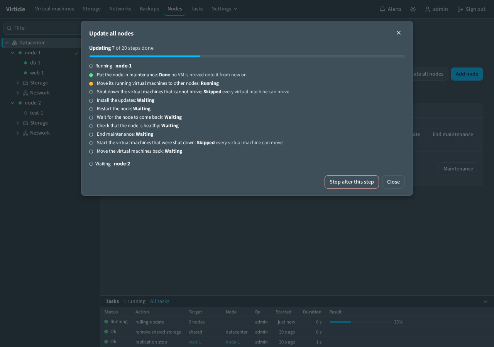

**When a step fails**, the run stops and the page says in words what state things are in: which node is in maintenance,
which VMs run elsewhere, which are shut down. Then choose:

| Button | Does |
| --- | --- |
| **Continue** | Runs the failed step again and goes on. |
| **Put things back** | Ends maintenance, starts the VMs that were shut down, moves VMs back, and ends the run. |
| **Dismiss** | Leaves things as they are and clears the alert. |

**Stop after this step** ends a healthy run the same way. A failed or stopped run raises an alert; a finished run sends a
notification.

Good to know:

- It does not start while any node is offline, a selected node is in maintenance or has no node command, a migration or
  evacuation runs, or a node's updates cannot be read (a broken package repository stops it before anything changes).
- It installs every available update with the system's own tool (`dnf`, or `apt-get` without questions, keeping changed
  configuration files). Packages the tool holds back are reported, not forced. There are no scheduled updates.
- A restart that does not come back within 12 minutes stops the run: look at the machine, then choose **Continue**. A VM
  that does not shut down by itself within 3 minutes also stops it; it is never powered off by force.
- A restart you do yourself, with VMs running, behaves differently on Debian and Ubuntu: the system's `libvirt-guests`
  service shuts the VMs down one after the other and waits up to 5 minutes for each that ignores the request. The rolling
  update moves the VMs first, so use it instead.
- A controller that restarts during a run carries on with it. Details and the API are in
  [reference.md](reference.md#rolling-updates).

## Virtual machines

### Create

1. **Virtual machines > New VM** (or right-click a node > **Add VM**).
2. Pick what to install from:
   - **Installer ISO**: boots an ISO from a pool. Upload ISOs under Storage.
   - **Disk image**: copies a cloud image. Open **Cloud-init** to set the
     user, password and SSH key. The guest agent is installed too.
   - **Empty disk**.
3. A Linux VM gets UEFI firmware unless you choose BIOS under **Advanced** (a node without UEFI firmware gets BIOS).
   UEFI guests usually need at least 512 MiB. For Windows, set **Guest OS type** to **Windows**: it picks UEFI,
   Secure Boot and a virtual TPM for you.
4. **Advanced** holds the CPU type, **Firmware**, Secure Boot, TPM and **Existing volume** (use a volume as the
   disk as it is). When you pick an existing volume, Virticle looks at its first sectors: a disk without an EFI
   system partition can only start with BIOS, and a disk with one and no BIOS boot code only with UEFI. The
   other choice is then greyed out with a note. Leave **CPU type** on **Cluster baseline** unless you need host
   features: it is the best CPU every online node can run, so live migration works.
5. **Create**. Every new VM gets a serial console.

### Manage

- The **Overview** tab shows a console preview, state, guest agent, addresses,
  passthrough devices and live usage. A replicated VM also shows a **Replication** row: the standby node and the
  time of the last copy. Click it to open the replication dialog.
- **Actions** holds everything else:

| Menu | Items |
| --- | --- |
| Power | Start, stop and restart, gracefully or forced. |
| Edit Settings | Name, CPU, memory, and the other Hardware cards. |
| Snapshots | Take, manage, schedule. |
| Clone | Clone the VM (shut it down first). A template is cloned linked; **Advanced** offers a full copy. |
| Convert to template | Optionally resets the identity of a running guest. **Convert back to a VM** undoes it. |
| Migrate | To another node, or move a disk to another pool. |
| Replication | Keep a standby copy on another node ([Replication and failover](#replication-and-failover)). |
| More | **Edit XML**, and **Delete VM** (shut the VM down first; its disks are deleted too unless you untick the box). |

Sync guest clock is under **Power**.

- **Tags** sit beside the name. Click **+ Add Tag**; filter by tag in the tree
  and the VM list.
- Guest details (OS, addresses, disk use inside the guest) need the QEMU guest
  agent installed in the VM.

## Console

- **Display (VNC)** is the VM's screen. **Serial console** is a text terminal.
- **Keys** sends combinations the browser would swallow. **Paste text** types
  your clipboard into the guest.
- A VM without a serial console: the **Console** tab offers to add one.
- Viewers cannot open a console.

## Hardware

- Each card edits one area: CPU and memory, firmware and TPM, boot order,
  CD-ROM, disks, network interfaces, passthrough and **Advanced** (CPU mode,
  pinning, huge pages).
- A change that cannot apply to a running VM is saved and marked as applying
  at the next start.
- **Passthrough** lists the host's PCI devices. A device shares its IOMMU
  group with others; the dialog shows what moves together. The host needs
  IOMMU enabled in firmware and on the kernel command line. A graphics card
  that the host itself is using cannot be attached.
- **Speed limit**: in the network interfaces list, **Edit** a card and enter a
  **Speed limit (Mbit/s)**; empty means no limit. It limits both directions and
  applies at once to a running VM. **Advanced** sets download and upload
  separately. The list shows "limited to ..." only for cards that have a limit.
  The node needs `tc` (package `iproute2`, or `iproute-tc` on Rocky and Alma).
- **Actions > More > Edit XML** edits the full libvirt definition.

## Snapshots

- **Take snapshot** runs as a task with a progress bar.
- The tree shows which snapshot the VM is based on (**You are here**).
- The round arrow reverts; the bin deletes. **Delete snapshots** deletes several.
- **Set up schedule**: interval or daily, keep the newest N.

**You do not choose the kind of snapshot.** Virticle picks the one that works on the node (internal, in the disk
file, or external, in extra files). A running VM can save its running state with the snapshot, which pauses the guest
while memory is written; without it the guest keeps running and the snapshot is of the disks only.

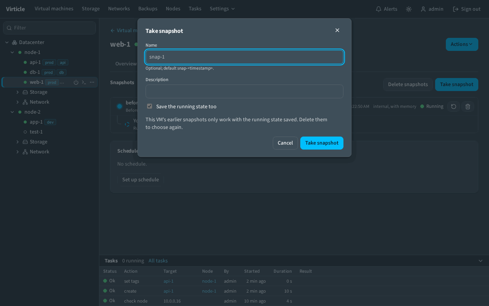

**Save the running state too** is greyed out, with a hint underneath, when only one answer works for this VM:

- A VM keeps one kind of snapshot until all its snapshots are deleted, because libvirt cannot delete a snapshot tree
  that mixes both kinds. If the earlier snapshots need the running state, the box stays ticked; the hint says so and
  that deleting them lets you choose again.
- On a node that confines QEMU with AppArmor (Debian), only snapshots with the running state can be deleted reliably, so
  the box stays ticked while the VM runs.
- A VM that is shut off has no running state: the dialog says "Shut off: disk only."

When no snapshot can be taken, the dialog says why and what to delete first.

## Backups

A backup is a copy of a VM's disks and definition in a directory pool, on this node or another. A running VM keeps
running. Snapshots and TPM state are not part of a backup.

1. Open the VM's **Backups** tab.
2. Choose **Back up now**, pick the target node and pool, and set **Keep the newest** (older backups of this VM in that pool
   are deleted; 0 keeps all).
3. **Restore** puts a backup back as a new VM or over the original (the original must be shut off).
4. **Set up schedule** and **Save schedule** make backups run by themselves: every so many minutes or hours, or daily.

**Frozen file systems.** For a running VM with the QEMU guest agent connected, Virticle freezes the guest's file systems
for the instant the backup starts and thaws them right after, so the backup is as consistent as a clean shutdown would leave
the files (databases and journals included). The task says "guest file systems frozen" or "not frozen:" with the reason (no
guest agent, agent not answering). If the freeze fails the backup is made anyway. Scheduled backups freeze the guest the same way.
A shut-off VM has nothing to freeze. If Virticle cannot thaw the guest afterwards, the task fails and says how to thaw it by hand.

The **Backups** page in the top bar lists the backups of every VM on every node. The backup of the controller itself is
under **Settings > Controller backup** ([controller-backup.md](controller-backup.md)). **Export** downloads a backup as one
file; **Import from file** on the Backups page of another installation brings it back. The format is in [reference.md](reference.md#backup-format).

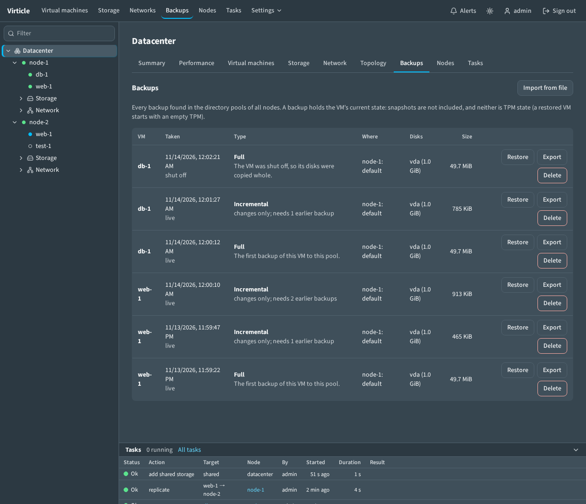

### Full and incremental

You do not choose. Virticle makes the backup that is possible and the list says which it is, with the reason when it is full.

| Type | What it holds |
| --- | --- |
| **Full** | Every disk, whole. |
| **Incremental** | Only what changed since the earlier backup of the same VM in the same pool. Small and quick. |

A backup is full when:

- it is the first one of the VM to that pool, and after every 7 backups (so a restore never needs a long list);
- the VM was shut off, or a disk is not qcow2;
- a disk was added, removed, resized or moved, a snapshot was reverted, or the VM was moved, restored or stopped unexpectedly;
- an earlier backup it would build on is missing or damaged.

Good to know:

- While a backup runs, its dialog says "Planned as an incremental backup", because libvirt can still refuse it. When the run
  is over, the dialog and the list show what was made.
- **Restore** works from any entry. Virticle puts the earlier backups it needs together. An entry whose earlier backups are
  missing says it cannot be restored.
- **Keep the newest** counts backups. An incremental backup is never kept without the backups it needs, so a few more than
  that number can stay for a while.
- **Delete** on a backup that later incremental backups need deletes them too. The dialog names how many.
- **Export** of an incremental backup puts the whole chain together into one full backup file.
- If the controller stops in the middle of a backup, that backup is lost. A later backup removes the half-written files.

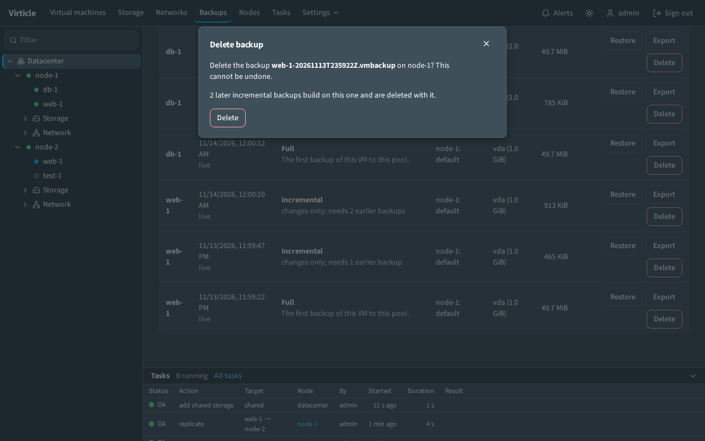

## Replication and failover

A VM can have a copy on a second node, never older than its interval, that you start with one click when the first node
fails. There is no shared storage: the copy is a set of disk files on the standby node. Failover is by hand; what
automatic failover would need is in [backlog-ha.md](backlog-ha.md).

### Set it up

1. Open the VM, choose **Actions**, **Replication**, then **Set up replication**.
2. Pick **Replicate to** (the standby node) and **Every** (5 minutes, 15 minutes, 30 minutes, 1 hour, 6 hours or 1 day).
3. Choose **Start replication**. The first copy sends the whole VM; later copies send only what changed. The pool on the
   standby is chosen for you.

Each copy of a running VM freezes the guest's file systems for the instant it starts, the same as a backup does, when the
guest agent is connected; the task says whether it did. A copy is made without the freeze if the freeze fails.

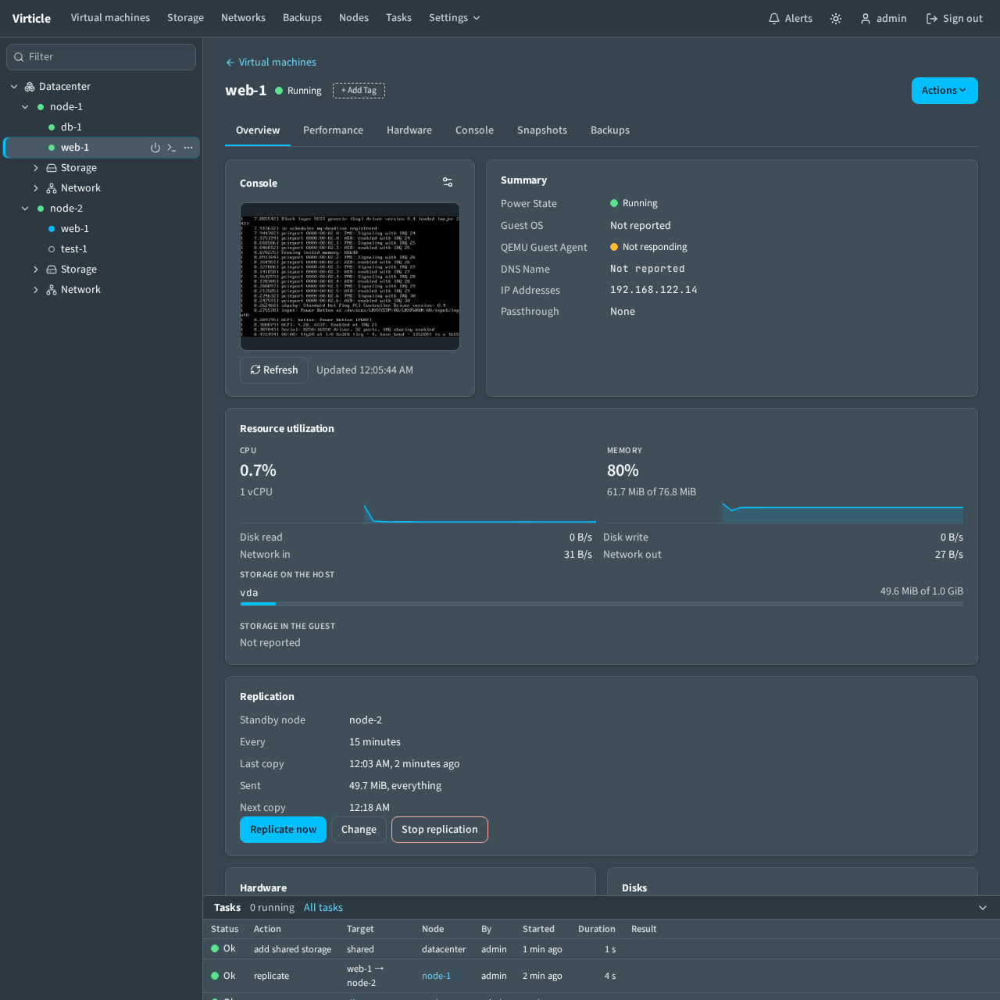

The dialog shows the standby node, the last copy (time and age), how much was sent, and when the next copy is due. It warns
when a run failed or the copy is older than twice its interval. **Replicate now** copies at once, **Change** edits the
settings, **Stop replication** ends it.

**What it needs.**

- qcow2 disks and no passthrough devices; the dialog says what to change.
- On the standby node, the VM's networks and bridges, and a pool with room for the changes (or for the whole VM at the
  first copy and after a full one). When there is not enough room the run fails and the earlier copy is kept.

On the standby the VM appears with the state **Replica**. It is inert: it cannot be started, edited, backed up, moved or
deleted with the normal buttons, and backups, schedules, evacuation, network checks and bulk actions skip it. Its definition
(CPU, memory, networks, firmware, UEFI variables) follows the source after every copy.

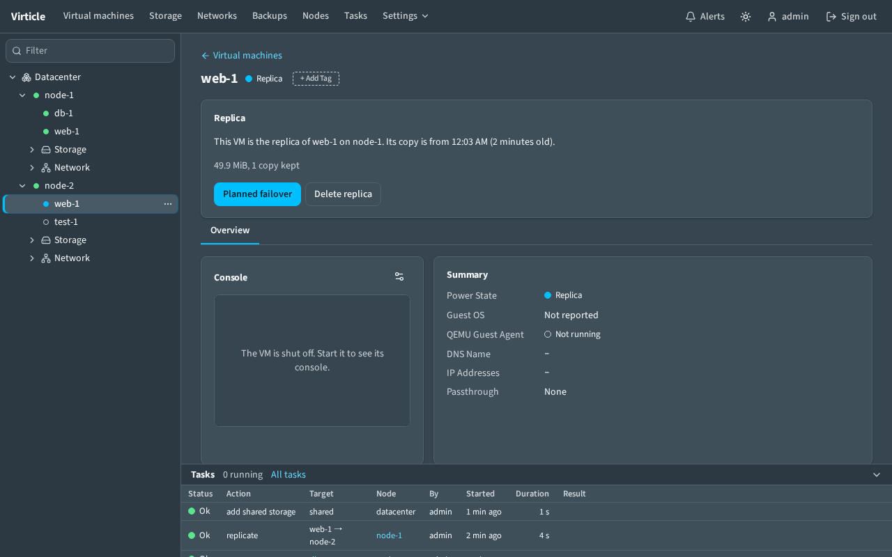

### Fail over

| | Source node online | Source node offline |
| --- | --- | --- |
| Button on the replica | **Planned failover** | **Start here from the copy of HH:MM** |
| What happens | The VM is shut down, the last changes are copied, the VM starts on the standby, and replication runs back to the old node. | The VM starts on the standby from the newest copy that reads. |
| What you lose | Nothing. | Everything the VM wrote after HH:MM. |

1. Open the replica on the standby node.
2. Choose the button. The confirmation states what is lost and, for an offline node, the risk below.
3. Confirm. The VM runs on the standby, and the replica page becomes a normal VM page.

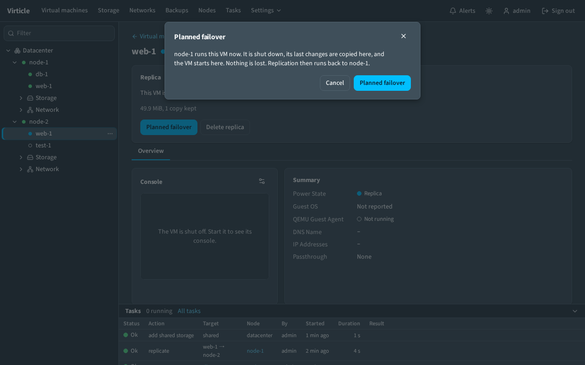

**What Virticle checks before an unplanned failover.** The confirmation asks the standby node, which may see more than
the controller does:

1. Can the standby reach the old node directly, and is the VM running there? If so, the failover is refused: use
   **Planned failover** when the controller can reach the node again, or shut the VM down on the old node.
2. Does the VM still answer on the network? For each network card on a bridge that the standby has too, the standby asks
   for the addresses the VM had at its last copy (ARP requests, 2 seconds; the standby needs an address of its own on that
   bridge, and the VM's addresses come from the guest agent, else the DHCP leases or the host's ARP table). If the VM answers, the dialog warns and the button
   needs the box **Start anyway**.

The dialog says in one line what was checked, or that nothing could be checked (the VM has only NAT networks, no
address is known, or the standby cannot reach the old node because the node-to-node access is not set up). A check that
cannot be made never stops the failover.

**What remains.** Virticle cannot stop a node it cannot reach. A node that is cut off from the controller and from the
standby, but still reachable by your clients, looks dead to both checks. If the VM runs on there, two copies run at once
with the same MAC and IP addresses. Each has its own disks, so no data is destroyed, but the copies diverge and you must
throw one away. Fail over only when you know the node is down.

**The start guard.** `virticle node prepare` puts a libvirt hook on every node (`/etc/libvirt/hooks/qemu.d/virticle-guard`;
an administrator's own hook is not touched). Before a replicated VM starts, the hook asks its standby whether it started
the VM from its copy. If it did, the start is refused with "this VM was started on NODE from its copy; it is kept off
here. Use Replicate back in Virticle." This stops an old node that reboots, or an administrator's `virsh start`, from
running the VM twice. If the standby cannot be reached, does not answer within 5 seconds or answers badly, the VM
starts: a dead standby never keeps a healthy VM down. Other VMs are not affected. Prepare checks that libvirt runs the
hook on that host (it starts a test VM that the hook refuses on purpose) and says so in the **Start guard** row.
The guard also covers the **Old copy** of a failed-over VM: it asks the node that took the VM over and refuses the start
while that node still holds the VM, so a `virsh start` of the old copy fails too. On Debian and Ubuntu, prepare adds one
AppArmor rule block to `/etc/apparmor.d/local/usr.sbin.libvirtd` so that libvirt may run the hook; `node unprepare`
removes it.

**When the old node comes back.** Its VM is marked **Old copy**. Replication from it is switched off, it is powered off at
once if it is running (as soon as the controller's connection to the node is up again, and in the minute pass as a second
net), it cannot be started, and an alert is raised. Which of the two VMs is old is decided by a counter that every failover raises, never by the clocks of the nodes,
and it is stored on the nodes: a controller that was down during the failover, or restored from an older backup, comes to
the same answer. Virticle never deletes its disks by itself.

1. Open the old copy and choose **Replicate back**. The running VM is copied to this node as a new replica (always a full
   copy), and the old copy and its disks are deleted when that copy is complete. Or choose **Delete VM** to discard it.
2. When the copy is current, use **Planned failover** on the replica to fail back.

After a planned failover replication back starts by itself. If the controller stopped at that moment, the old VM is still
marked when it is back, and **Replicate back** on it does the rest.

### Good to know

| Situation | What happens |
| --- | --- |
| **Stop replication** | Asks whether to delete the copy on the standby (yes by default). |
| Deleting a replicated VM, one by one or in bulk | Asks "Also delete the replica" (yes by default). A replica you keep stays on the standby and can still be started from its page. |
| Moving the VM to its standby node (migration, evacuation, rolling update) | Allowed. The replica steps aside, the VM moves, and replication back to the node it left starts at once with a full copy. If the move fails, the replica is put back. |
| Moving it to a third node | Replication continues; the next copy sends everything again. |
| Snapshot revert; disk added, removed, resized or moved; restore | The next copy is a full one. Nothing to do. Restoring a backup over a replicated VM keeps its replication. |
| The VM is shut off | It is copied once after it stops, then not again until it is started. When only the changes can be sent, the VM is started paused for a moment and Start is refused until that ends (seconds to minutes; the error says so). |
| A node is removed from Virticle | Replication to it is switched off. Replicas it held are out of reach; the replica alert (copy too old) stays until you start one from its page or delete it. |
| Virtual TPM | An emulated TPM 2.0 (what Virticle creates for a Windows VM) is copied with every run, so a disk locked to it opens after a failover. A TPM of another kind is not copied: setup warns, and the VM starts with an empty TPM on the standby. |
| Network | Copies use the migration network and its limit. |
| Clones | A cloned VM is not replicated. |

Two more rules:

- **A VM with a disk on shared storage cannot be replicated.** That disk is already on both nodes. Use **Migrate** for such a VM; it moves between the nodes without copying the shared disk.
- **A planned failover waits up to 3 minutes for the guest to shut down.** If the guest does not react, nothing is changed and the VM keeps running. Shut it down from inside the guest, or power it off with **Actions**, and try again.

How it works inside, and the API, are in [reference.md](reference.md#replication).

## Migration

1. Choose **Actions > Migrate > Migrate to another node**.
2. Pick the target node.
3. Read the pre-flight checks. This is the list of checks shown before a
   migration. It covers CPU, memory, networks, storage, SSH between the nodes
   and the migration ports.
   - A red row blocks the move and names the fix.
   - A yellow row is a warning.
4. Choose **Migrate**. With **Live migration** ticked the VM keeps running.

Good to know:

- Disks are copied along. You do not need shared storage.
- The controller coordinates a live migration. Memory and disk data go
  directly from node to node. The nodes need no SSH trust between them for it.
- When files have to be copied (disks on local storage, snapshot files, a
  backup restored on another node), they go straight from node to node. The
  controller sets up a key on each node for this. The key can only deliver a
  new file into a storage pool. It works between any two nodes, Service
  account or Root.
- Two pre-flight rows tell you about the network between the nodes:

  | Row | It tells you |
  | --- | --- |
  | **SSH between nodes** | Whether a file copy is needed and whether the path works. |
  | **Migration ports** | Whether the target's firewall lets the migration data through. |

- The streams are encrypted when both nodes are set up. The controller sets
  this up by itself on every prepared node; see **Settings > Encrypted
  migration** on the node. If another controller installed the certificates, it
  says **Set up by another controller**; **Fix** replaces them after you
  confirm. Virticle never replaces them by itself.
- A Debian node and a RHEL-family node cannot exchange VMs.

### Migration network

By default a node receives migration data at its management address, the one
the controller uses. When a node has more than one network card, choose which
one carries the data, so that management traffic is not held up by a big
transfer:

1. Open the node, **Settings**, and choose **Change** next to **Migration
   network**. The row appears only when the node has more than one address.
   (The same list is under **Advanced** in **Edit connection**. In the
   **Network** tab, **Use for migration** next to an address does the same,
   and a **Migration** mark shows the address in use.)
2. Pick the card, for example `enp2s0 (10.0.1.5), 10 Gb/s`. **Same as
   management** is the default.

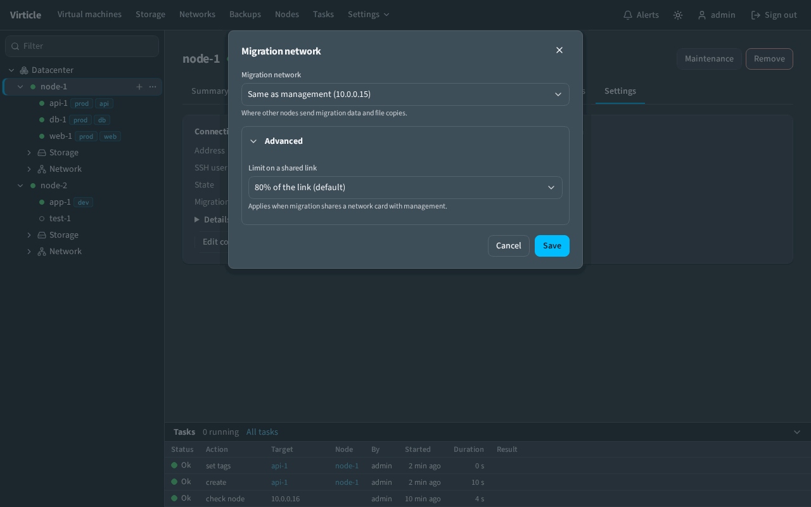

Saving checks that the other nodes can reach the address on the migration
ports and on SSH, and renews the node's encryption certificate for it at once.
A problem with another node is a warning; the setting is saved anyway. The
data of live migrations, copied files (offline migration, snapshots) and
backups restored on another node all use this network, so the firewall must
allow the migration ports and SSH there. The pre-flight row **Migration
network** names the cards in use and the address each node sends from. A node
sends from the address its route to the other node picks. With two cards on
one subnet that can differ from the address under **Settings**; the row then
says so.

When the data travels over the same card as management, the transfer is
limited so that it cannot fill the link:

| Situation | Limit |
| --- | --- |
| Migration has its own card on both nodes | None. |
| Migration shares the management card, link speed known | 80% of the link, for example 800 Mbit/s on 1 Gb/s. The lower of the two nodes' limits applies. |
| Migration shares the management card, link speed unknown (virtual network cards often report none) | None. The pre-flight row **Transfer limit** says so. |

Change this for a node under **Advanced** (**Limit on a shared link**):
**80% of the link (default)**, **No limit**, or **Custom (Mbit/s)**. The limit
covers the memory stream, the live disk copy and file copies. Libvirt counts
the whole disk, including empty space, so a large sparse disk takes
longer than its stored data suggests. Two networks on one subnet need a route
that sends the traffic to the chosen card; use a separate subnet or VLAN for a
dedicated migration network.

## Storage

- Select a pool to see its volumes.
- **Image catalogue** downloads common cloud images. **Download from URL** and
  **Upload image or ISO** bring your own.
- **Import disk or OVA** converts foreign disk formats.
- **New pool** adds a directory, LVM or iSCSI pool. Only directory pools
  are tested. For NFS use **Add shared storage** (below).
- Per volume: clone, resize, delete.

### Shared storage (NFS)

Shared storage is an NFS share that every node mounts at the same path. A VM whose disks are on it moves between nodes
without copying them: a live migration takes seconds, whatever the disk size. Without it, every disk is copied on each
migration.

**What you need.** An NFS server that the nodes reach on port 2049, and an export the nodes may write to (table below).
A node prepared with an older Virticle needs **Prepare** once more: it installs the NFS client, turns on the SELinux setting
`virt_use_nfs` (Rocky, Fedora) and makes libvirt start its storage before the VMs, so VMs on NFS start at boot.

**Add it**

1. Open **Storage** in the top bar and choose **Add shared storage**.
2. Enter the **Name** (also the folder: `/mnt/NAME`), the **NFS server** and the **Export path**.
3. Choose **Add shared storage**. Every online node mounts the share and checks that a VM disk can be made on it. If that
   fails, the dialog says what to change on the server, and nothing is left half done.
4. To use it, pick the pool with that name in **New VM** or **New disk**.

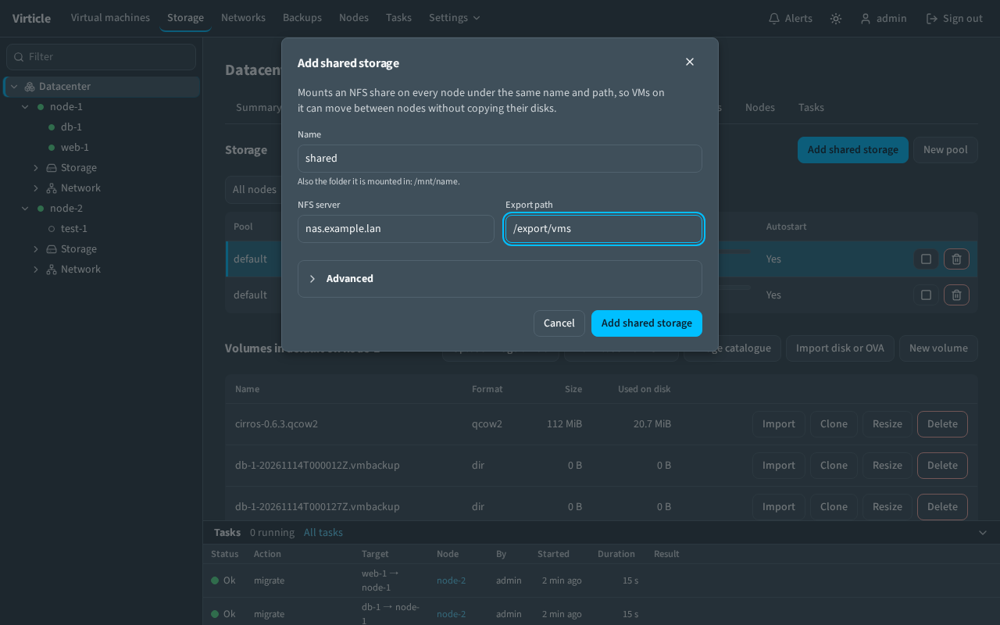

Under **Advanced** you can leave nodes out; a VM can only move between nodes that all have the storage.

The share is one row in the **Shared storage** table, with the nodes that have it. A node added later shows "Not on NODE"
and an **Add to NODE** button. **Remove** unmounts the share on every node. It is refused while a VM has a disk on it (move
the disks or delete the VMs first). Virticle never deletes the files on the server.

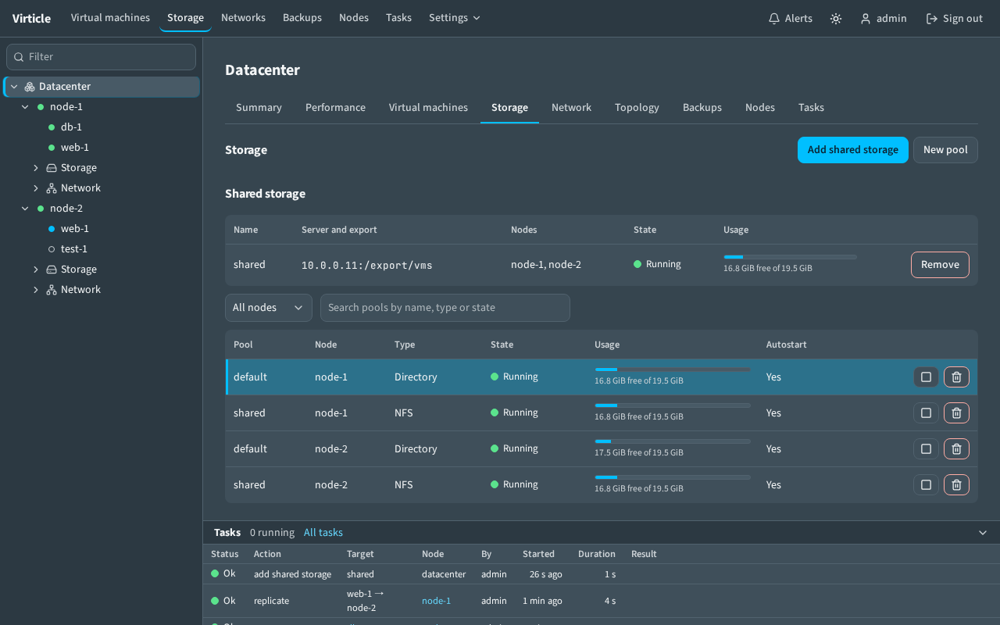

**Export settings on the server**

| Setting on the server | Works | What to know |
| --- | --- | --- |
| `rw,no_root_squash` for the nodes | yes | Simplest. Root on the node may write, and libvirt hands each disk to the VM user when the VM starts. Works when the nodes' VM users have different ids. |
| `rw,all_squash,anonuid=107,anongid=107` | yes | The server treats every user as that id. Give the export directory to that id (`chown 107:107`). The VM user is 107 on Rocky, Fedora and Red Hat, 64055 on Debian and Ubuntu; with `all_squash` one number works for a mixed cluster. |
| `root_squash` (the default) | no | Root becomes `nobody`, so VM disks cannot be made. Add refuses and names the setting to change. |
| `ro` | no | The nodes must write. |
| NFS version 3 only | yes, with care | Add says so in one sentence. The locks that stop two nodes from running one disk then need the server's lock service (`rpc.statd`, `lockd`) reachable from every node. Version 4 has them built in. |
| Kerberos (`sec=krb5`) | no | Not supported. |

The NFS version and the mount options are not settings. The mount takes the highest version both sides offer (normally 4.2)
and is **hard**: a program that talks to an unreachable server waits instead of getting an error. A server may be spelled
as a name on one node and as an address on another; Virticle treats it as one server.

**Migration.** The migration check says which disks are copied and which are not, for example "no disk is copied: every disk
is on shared storage that both nodes mount (vda on nas)". An offline migration of such a VM only moves its definition.
Snapshots stay valid.

**When the server does not answer**

| What | Detail |
| --- | --- |
| Storage tables | The share shows **Unavailable** within about ten seconds, with a line naming the server. |
| Alert | A critical alert (kind `storage-unavailable`) after about two minutes; it clears by itself when the server answers and goes to the notification destinations. |
| Virticle | The pages keep answering. Anything that would read the share (volume lists, snapshot and clone pages, disk moves, starting or changing a VM on it) is refused with a message that says the storage is away. Other storage and VMs are not affected. |
| VMs on the share | They keep running. Whatever needs their disk waits and then continues, without errors and without losing data, up to about a minute after the server is back. The VM page shows a note. |
| Debian and Ubuntu (one libvirt daemon) | Pages that list the node's storage or read a VM's definition answer within seconds that the node's storage is not answering, instead of showing the share as Unavailable. |
| A node that boots while the server is away | It boots normally. VMs on the share do not start; Virticle mounts the share when the server answers (within an hour of the boot), and you start those VMs by hand. On Debian and Ubuntu all of libvirt waits for the mount: the node shows Offline until the server answers, and about 20 seconds later libvirt is back with its autostart VMs running. |
| Restarting a node | It takes several minutes while the server is away, because the node waits for it before it lets go of the mount. |

Do not ask a node's libvirt about the share by other means during an outage (`virsh pool-refresh`, another management
tool): with a hard mount that call waits for the server and holds the node's storage service with it.

**What it does not do.** There is no automatic failover. If a node dies, its VMs stay defined only on that node and
Virticle cannot start them elsewhere yet; the disks on shared storage are safe. See [backlog-storage.md](backlog-storage.md).
Technical facts and the API: [reference.md](reference.md#shared-storage-nfs).

## Networks

Everything about a node's networking is in one place: the **Network** tab. The node page shows that node; the
**Datacenter** page (and **Networks** in the top bar) shows all nodes, each with the same buttons. The tab draws how
virtual machines reach the network, like a VMware standard switch. **Refresh** reloads it; it also reloads by itself
when networks or virtual machines change. In the Datacenter view the first three nodes are open and the others open
on a click, and a network that has the same name on several nodes gets the same coloured edge. On a node with many
switches the first four are open and the others show one line (name, state, how many networks and how many are
stopped); select the arrow to open one. The filter finds a switch, a network or a virtual machine by name.

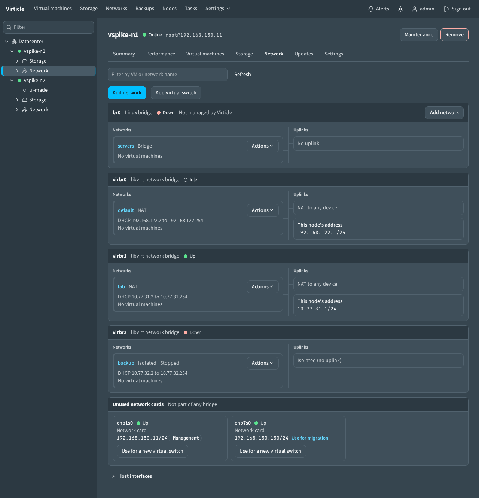

| Part | What it is |
| --- | --- |
| Switch | A bridge on the node: a Linux or Open vSwitch bridge, or the bridge libvirt made for one of its networks. |
| Networks (left) | The networks on the bridge (mode, VLAN, DHCP range, **Stopped**) and **Direct to bridge** for VM interfaces that use the bridge itself. Each lists its virtual machines with MAC and IP address. Select the name for the details; **Actions** changes the network. |
| Uplinks (right) | The network cards or bonds attached to the bridge, with link state, speed and addresses. A NAT, routed or isolated libvirt network has none and says so instead. |
| This node's address | The node's own address on the switch. |
| Unused network cards | Cards that belong to no bridge. |
| Host interfaces | Every interface of the node with type, state, MAC address, addresses, MTU and speed (folded; select it to read the node). |

The card or bridge that holds the address the controller uses to reach the node is marked **Management**.
Addresses of virtual machines come from DHCP leases, so a guest with a fixed address shows none. Uplinks of Open
vSwitch bridges are not listed. A network that is stopped, or whose bridge is gone, is still drawn, with
**Stopped**, so you can start or delete it.

| Role | Can |
| --- | --- |
| Viewer | Read everything, including the details of a network. No buttons. |
| Operator | Also **Add network**, and **Actions** on a network. |
| Administrator | Also **Add virtual switch** and everything on a switch (see [Virtual switches](#virtual-switches)). |

### Add a network

Select **Add network** on the node. It asks what the virtual machines should connect to:

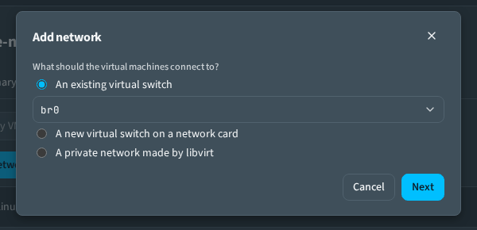

| Answer | What happens |
| --- | --- |
| An existing virtual switch | Pick the switch, then enter a name (and a VLAN where the switch has them). Same as **Add network** in the box of a switch. |
| A new virtual switch on a network card | The **Add virtual switch** dialog opens (see [Virtual switches](#virtual-switches)). When the switch is in place, **Add network on ...** continues with its first network. Administrators only. |
| A private network made by libvirt | **New private network**: NAT (the VMs get addresses from the node) or isolated. The address is filled in with the next free one. **Advanced** has routed, open, your own definition (XML), the DHCP range, the bridge name and the DNS domain. |

The new network appears in **New VM** and **Add network interface** like any other.

### Change a network

Select the name of a network for its details; **Actions** on the network has:

- **Start** or **Stop**. Stopping asks first and lists the running VMs that lose their connection.
- **Autostart** or **No autostart**: whether the network starts with the node.
- **Delete**. The dialog lists the VMs still attached; they will not start until you give them another network.

The details show the mode, bridge, address, DHCP range and attached VM interfaces, the **DHCP leases**, the **DHCP
reservations** (add, edit and remove; changes apply at once, without restarting the network) and the **Definition (XML)**, which you
can edit (a running network takes it after it is stopped and started again). The details of a stopped network say
"Start the network to see leases."

### Network alerts

The alerts (bell in the top bar, and [Notifications](#notifications)) include some about network links, checked every
minute and raised only when seen twice in a row:

- **Network card X on Y has no link**: a warning; critical when it is the only uplink of a bridge that carries the
  node's address or has running virtual machines.
- **BOND on Y runs on 1 of 2 cards**: a bond has lost a card.
- **LACP is not answered by the switch for BOND on Y**.

Cards that belong to no bridge or bond and carry no address never alert.

### Networks that differ between nodes

A virtual machine can only move to a node that has a network of the same name. When nodes of the same distribution
family and architecture do not all have the same networks, or have them with another kind, VLAN or bridge, the
Datacenter **Network** tab shows a line "N networks differ between nodes." Open it for a table of
what differs where. A bridge network that is missing on a node, and whose bridge exists there, has **Create on
node**. NAT and isolated networks are not copied, since a copy would be a different network. Only when a running
virtual machine uses a network that no other node has, an alert "Networks differ between nodes; some virtual
machines cannot migrate." is raised.

### Virtual switches

Administrators can create and change virtual switches on the Network tab of a node (and of the Datacenter page, where
each node has its own button). Nothing else is needed on the node: Virticle writes the node's own network settings.

| Word in the app | What it is |
| --- | --- |
| Virtual switch | A Linux bridge on the node. |
| Uplink | A network card the virtual switch uses to reach the outside network. A switch without one connects the virtual machines on this node only. With two or more uplinks the cards work together as a bond. |
| Network | What a virtual machine attaches to. A network on a virtual switch is a libvirt network in bridge mode, so it appears in **New VM** and **Add network interface** like any other. |
| VLAN | A tag on a network, so that several networks share one switch and one cable. |
| This node's address | The node's own address. When the uplink had one, it moves to the virtual switch and stays the same. A node can have more addresses on a switch, each on its own VLAN. |
| MTU | The largest packet the switch passes. 1500 unless you set it (for example 9000 for storage or migration traffic). |

**Add a virtual switch**

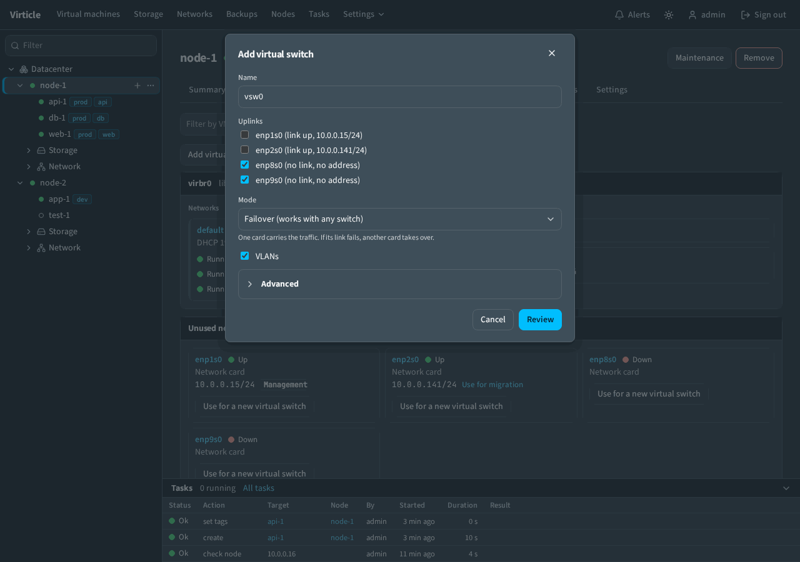

1. Open the node's **Network** tab and select **Add virtual switch** (or **Add network** and the answer "A new virtual switch on a network card"). On a card under **Unused network cards**, select
   **Use for a new virtual switch** instead.
2. Enter a name (the dialog offers `vsw0`, `vsw1` and so on) and tick the **Uplinks**: none for an internal switch,
   one card, or two or more for a bond. The dialog ticks the first free card that has no address; when every
   free card has one, nothing is ticked. A card with an address of its own loses it while it is in the switch (the
   review says so, and says when it is not the address the controller uses). With two or more cards the **Mode** select appears.
   Keep **VLANs** selected if you want VLAN tags. **Advanced** has the allowed VLAN ids (empty allows all), the MTU
   and the time the node waits for the controller to confirm (90 seconds).
3. Select **Review**. The dialog lists in plain words what will happen on the node; **Details** has the files and
   commands.
4. Select **Apply**. The dialog shows three steps: applying on the node, waiting for the node (with the seconds left
   before the node undoes the change), confirmed. You can close it; the result is also in the task log. When it is
   confirmed, **Add network on ...** continues with the first network on the new switch.

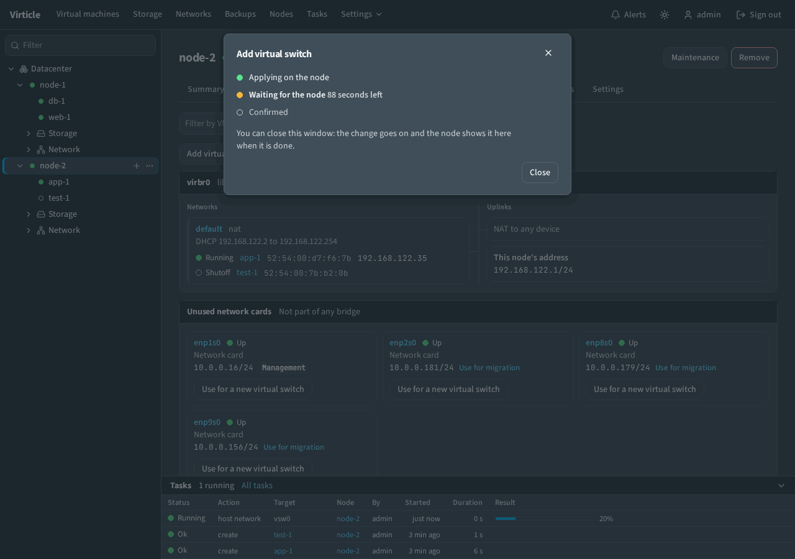

**Several uplinks.** Two or more cards on one switch work as a bond: if a cable or a card fails, the node and its virtual
machines stay connected. Choose the mode when you add the switch or later under **Edit uplinks**:

| Mode | Use it when | What happens |
| --- | --- | --- |
| Failover (works with any switch) | The cards go to ordinary switch ports, or to two different switches. | One card carries the traffic. If its link fails, another takes over. No setting is needed on the physical switch. |
| Load balance, needs LACP on the switch | The cards go to ports of one switch that are set up as an LACP group (link aggregation). | The traffic is spread over all cards. Without LACP on the other end the bond carries traffic on one link at best; the Network tab then says "LACP not answered by the switch". Cards of different speed are not combined well. |

The Network tab shows the bond as one uplink with its cards: each card's link state and, in failover, which one is active.

1. In the box of the switch, open **Actions** and select **Edit uplinks**.
2. Tick the cards the switch should have. A card with an address of its own loses it while it is part of the switch
   and gets it back when it leaves (the review says so). The card whose address moved to the switch stays until the switch is removed.
3. Choose the **Mode** if it is shown, select **Review**, then **Apply**.

A switch with a bond keeps it when you remove cards down to one; the one card then works like a plain uplink and you can add cards later.
The cards of a bond are set up so that the node keeps its address, also when the card that carried it joins the bond.

**This node's address on a VLAN.** A node can have addresses of its own on the VLANs of a switch, for example a network for
migration or storage. The switch must filter VLANs. The new address does not become the node's main address and adds no default route.

1. In the box of the switch, open **Actions** and select **Add this node's address**.
2. Enter the **VLAN id** (a new id is added to the allowed ids of the switch) and choose **From DHCP** or **Enter an address**
   (with prefix, for example `10.30.0.5/24`).
3. Only if this VLAN should carry the node's default route: **Advanced**, **Use this VLAN for the default route of this node**, and the gateway.
4. Select **Review**, then **Apply**. The address appears under **This node's address** with its VLAN. With DHCP the change does not wait for a lease.

**Actions** also has **Remove address on VLAN N** (not possible for the address the controller uses to reach the node). Moving
the node's main address onto a VLAN is not offered.

**MTU.** **Actions**, **Edit MTU** sets one MTU (1280 to 9000) on the cards, the bond, the switch and the VLAN addresses of the
switch together. The ports of the physical switch and the other nodes on that network must use the same MTU, or large packets
are lost. Virtual machines need the same MTU in their own network settings; libvirt does not take an MTU for a network on a host bridge.

**Add a network with a VLAN.** Select **Add network** in the box of the virtual switch (or at the top, then "An existing virtual switch"), enter a name and, if the
switch has VLANs, a VLAN number (empty means no tag). On an Open vSwitch bridge the number is an access VLAN. The dialog shows the ids already in use on the switch. When other
nodes have a virtual switch with the same name, **Create the same network on ...** is selected: a virtual machine can
only migrate to a node that has a network of the same name. **Actions** on the switch has **Edit VLANs** (refused while a
network or an address of the node uses an id you remove) and **Remove** (not possible while networks or virtual machines use the switch; the
node's address returns to the card). A bridge that somebody made by hand shows **Not managed by Virticle** and cannot be
changed here.

**If the node becomes unreachable.** Moving the address of the card the controller uses is the risky case. The node
saves its previous settings first and restores them by itself if the controller does not confirm within the confirm time.
The dialog then says "The node did not come back in time and restored its previous settings." If you reload the page
while a change is waiting, the node's section shows it with the seconds left and **Roll back now**; a change that was
rolled back is shown as one line you can dismiss.

**Which nodes.** Nodes that use NetworkManager, or netplan with systemd-networkd. A node that uses ifupdown is not
supported yet (the button is disabled and says so). VLANs on a virtual switch need libvirt 11 or later on the node. A
node prepared with an older version of Virticle must be prepared again.

## Notifications

Alerts show in the bell in the top bar. **Settings > Alerts** (administrators) lists where else they are sent: Slack,
Mattermost, Discord, or any web address (a webhook). Nothing is sent until you add a destination.

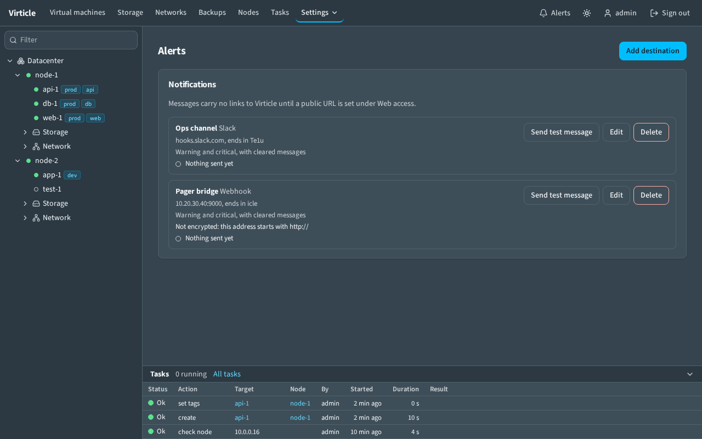

**Add destination** asks for a type, a name and the URL. Messages are sent when an alert is raised and when it
clears, for warnings and critical alerts. **Send test message** checks a destination at once and tells you in plain
words what the service answered. A destination that cannot be reached shows a red dot and **Failing:** with the
reason; Virticle tries a message again after 5 seconds, 30 seconds and 2 minutes, then gives up on that message.
More than 5 alerts raised in one minute arrive as one summary message.

| Service | Where to get the URL |
| --- | --- |
| Slack | 1. Open api.slack.com/apps and choose **Create New App**, **From scratch**. 2. Choose **Incoming Webhooks** and turn them on. 3. Choose **Add New Webhook to Workspace** and pick the channel. 4. Copy the **Webhook URL**. |
| Mattermost | 1. Open the main menu, **Integrations**, **Incoming Webhooks** (an administrator may have to allow integrations first). 2. Choose **Add Incoming Webhook**, give it a title and a channel. 3. Save, then copy the URL. |
| Discord | 1. Open **Server Settings**, **Integrations**, **Webhooks**. 2. Choose **New Webhook**, give it a name and a channel. 3. Choose **Copy Webhook URL**. |
| Webhook | Any address that accepts a POST with a JSON body, for example your own script. The body is described in the [reference](reference.md#alert-webhook-body). |

The URL is a secret: anyone who has it can post to your channel. Virticle keeps it encrypted, and after saving shows
only the host and the last four characters. To change it, edit the destination and enter a new one.

Under **Advanced** in the dialog: send **Critical only** instead of warnings and critical, switch off the message
when an alert clears, and, for a webhook, a secret that signs every body.

- Slack, Mattermost and Discord need an `https://` address that is not this machine or a link-local address.
  Private (LAN) addresses are fine, for a Mattermost in your own network.
- A webhook may use `http://` (the page warns that it is not encrypted) and may point at this machine or the LAN.
  Link-local addresses such as 169.254.169.254 (cloud metadata) are refused.
- Messages link to the right page in Virticle only when a public URL is set under **Web access**.
- The old `-alert-webhook` flag still works; it appears as one more destination that cannot be edited. A webhook
  address saved by an earlier version became the destination **Webhook** when you upgraded.

## Performance

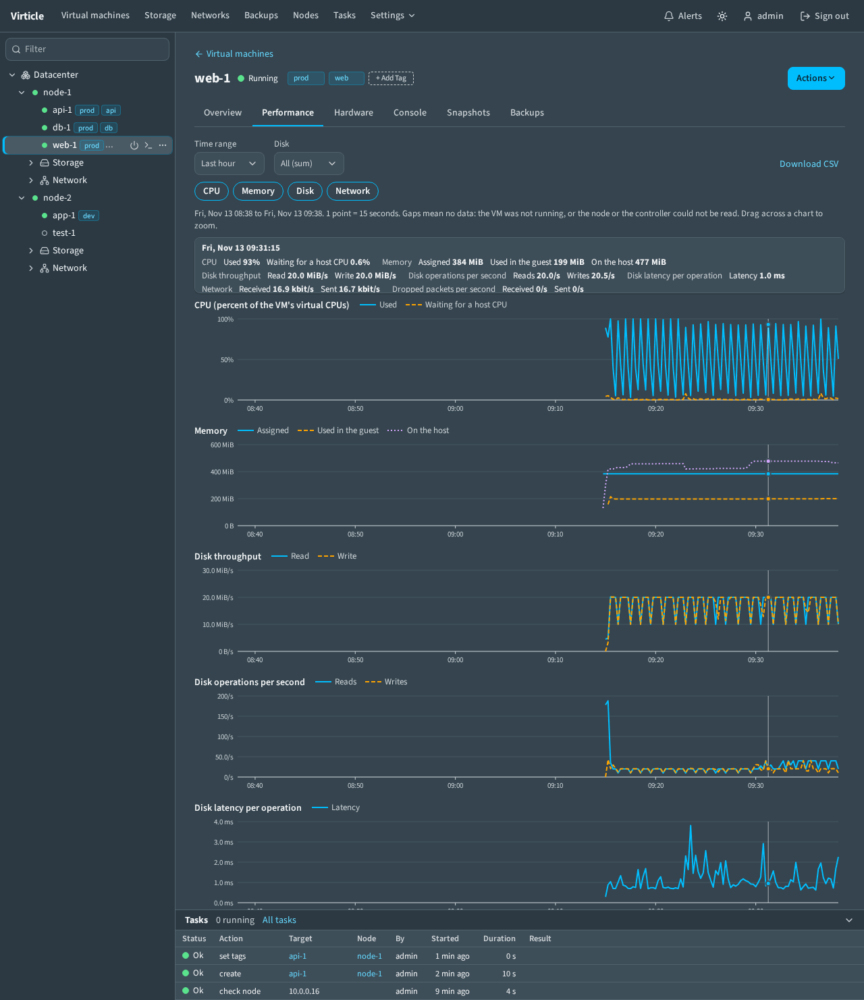

The **Performance** tab of a VM and of a node shows what happened in the last hour, 6 hours, 24 hours or 7 days, for
troubleshooting ("why was it slow at 03:00?"). The controller records every online node and all its VMs every 15
seconds, whether or not anyone looks, and keeps it like this:

| Age | One point is | Kept for |
| --- | --- | --- |
| Up to 2 hours | 15 seconds | 2 hours |
| Up to 48 hours | 1 minute | 48 hours |
| Up to 7 days | 5 minutes | 7 days |

Longer steps keep the average and the highest value, so a short spike stays visible: the line is the average, the light
band above it is the peak. The note above the charts says which step is in use.

**Controls.** *Time range* picks a preset; *Custom* shows two date and time fields (your local time). The chips switch
metric groups on and off: CPU, Memory, Disk and Network for both, plus Storage (pool use) and GPU on a node when there is
data. When a VM has several disks or network cards, or a node has several, a select appears for one device; the default
is *All (sum)*. For a node, the sum counts physical cards, not bridges.

**Reading the charts.** All charts share one time axis. Hover over a chart (or tap it) to read the values of every chart
at that time in the box above the charts. Drag across a chart to zoom into that time span; *Back* returns to the
previous range. A gap is a gap: the VM was not running, or the node or the controller could not be read; nothing is
drawn as zero. Small markers on the axis show that a VM started (triangle), stopped (square) or moved to another node
(diamond). *Download CSV* saves the current view for a spreadsheet.

**What is shown.**

- VM: CPU (percent of its virtual CPUs, and time spent waiting for a host CPU), memory (assigned, used inside the guest
  when the balloon driver reports it, resident on the host), disk (read and write throughput, operations, latency),
  network (bits per second, dropped packets).
- Node: CPU (used, user, system, waiting for disk, stolen) and load average, memory (used, cache, available, swap),
  disk per device (throughput, operations, active percent, latency), network per card and bridge, storage pool use, and
  GPU use, memory and temperature for NVIDIA cards that the node itself drives (the node needs `nvidia-smi`). A GPU passed
  through to a VM cannot be seen from the node; its usage is only visible inside the guest. AMD and Intel GPUs are not
  shown.

On a node's Performance tab, *Top virtual machines in this range* lists the top 5 by CPU, memory, disk and network;
each name opens that VM's Performance tab with the same range. The Datacenter has the same table for all nodes.

The history is stored in `metrics.db` in the data directory; deleting the file only loses the history. To feed Grafana or
another tool, see [metrics.md](metrics.md).

## Settings, users and tokens

The **Settings** menu in the top bar is for administrators. **Account** (your name in the top bar) is for everyone.

| Page | Who | What it does |
| --- | --- | --- |
| **Settings > Users** | Admin | Add accounts as viewer, operator or admin; reset a user's two-step sign-in. See [Roles](reference.md#roles). |
| **Settings > Sign-in** | Admin | Require two-step sign-in, sign in through an identity provider (OIDC) or a directory (LDAP). See [sign-in.md](sign-in.md). |
| **Settings > Web access** | Admin | Interface, port, HTTPS and reverse proxy. See [web-tls.md](web-tls.md). |
| **Settings > Alerts** | Admin | Where alerts are sent. See [Notifications](#notifications). |
| **Settings > Controller backup** | Admin | Download a backup of the controller, or keep a daily one. See [controller-backup.md](controller-backup.md). |
| **Settings > Audit** | Admin | Lists every state-changing request, who made it and from where. |
| **Account** | Everyone | Change your password, turn two-step sign-in on or off, create API tokens. |

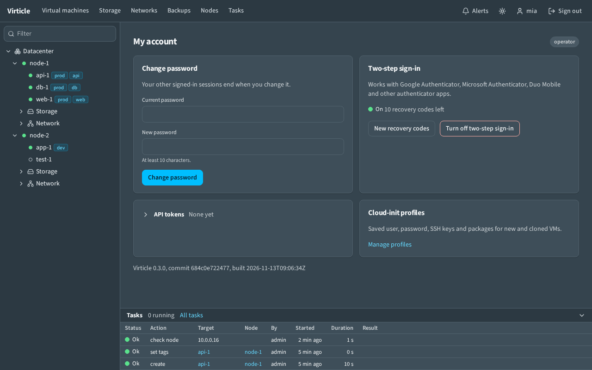

API tokens are described in [reference.md](reference.md#api-tokens). To read the numbers with Prometheus or Grafana, see
[metrics.md](metrics.md).

## Troubleshooting

| Symptom | Check |
| --- | --- |
| Node shows Offline | Node **Settings > Test connection**. It names the failing step. |
| Guest agent "Not responding" | Install and start `qemu-guest-agent` in the VM. |
| Migration blocked | Read the red pre-flight row. Usually a missing network or pool on the target, or a firewall between the nodes (SSH between nodes, Migration ports). |
| Migration or backup refused for a node | **Settings** says the node is not prepared: it has no node command, or one from an older version. Choose **Prepare this node** there, or run `virticle node prepare` for it again (see [install.md](install.md#upgrading)). |
| A virtual switch change did not stay | The node did not come back in time and restored its previous settings. Read the line in the node's **Network** tab, check the cable and address, and try again. From the node's console: [reference.md](reference.md#host-bridges-virtual-switches). |
| Charts have gaps | The VM was not running, or the node or the controller could not be read. Nothing is drawn as zero. |
| Locked out after a web access change | Wait 60 seconds for the automatic revert, or run `virticle web reset` and restart. |
| A web access change is waiting | Any page asks "Keep the new web access setting?" for an administrator, also right after signing in at the new address. Choose **Keep this setting**, or it is undone after 60 seconds. |
| Lost the phone with the authenticator | An administrator chooses **Reset two-step sign-in** for you. If you are the only administrator: `virticle user reset-2fa USER` on the controller. See [sign-in.md](sign-in.md#two-step-sign-in-authenticator-app). |
| "No ISO images on this node" | Upload one under **Storage**. |
| A task failed | **Tasks** shows the error in the Result column. |
| A rolling update stopped | The page says what state the nodes are in. Choose **Continue**, **Put things back** or **Dismiss** ([Update all nodes](#update-all-nodes-rolling-update)). |
| A VM shows **Replica** or **Old copy** and cannot be started | That is on purpose. A replica starts with **Planned failover** or **Start here from the copy of HH:MM**; an old copy has **Replicate back** or **Delete VM** ([Replication](#replication-and-failover)). |
| A shared storage shows **Unavailable** | The NFS server does not answer. VMs on it wait and carry on when it is back ([Shared storage](#shared-storage-nfs)). |
| A backup says **Cannot be restored** | An earlier backup it builds on is missing. Restore another entry, or delete this one ([Full and incremental](#full-and-incremental)). |
