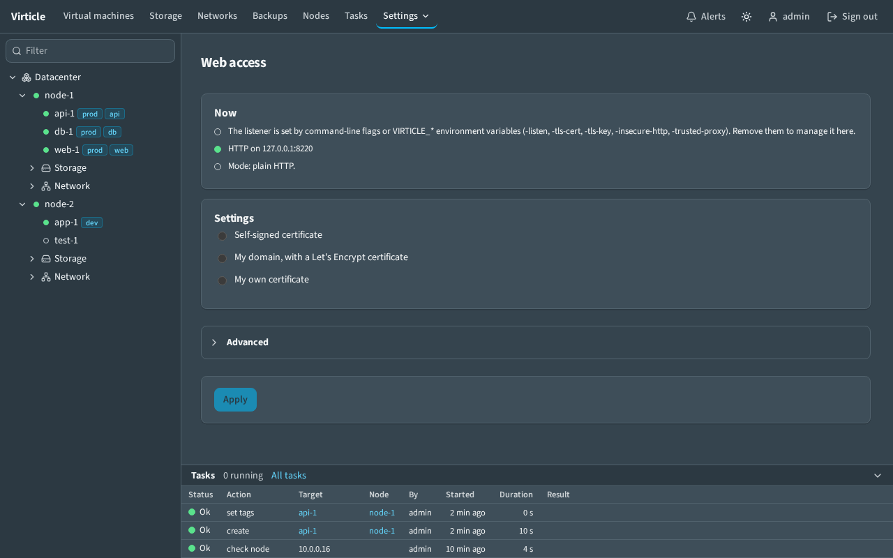

# Web access and TLS

The **Web access** page (administrators only, under **Settings** in the top bar) chooses how the controller serves its web UI and API. You can give the same settings on the command line, so a headless install works without opening the page.



A new install serves a self-signed certificate on port 8443 of all interfaces, so the page is reachable from another computer at once. The page offers three choices, and the rest under **Advanced**:

| Choice | What it does |
| --- | --- |
| Self-signed certificate (default) | HTTPS with a certificate the controller makes itself. |
| My domain, with a Let's Encrypt certificate | HTTPS with a certificate obtained and renewed from Let's Encrypt (ACME). |
| My own certificate | HTTPS with a certificate you provide. |
| Advanced: Plain HTTP, not encrypted | Plain HTTP on one address, 127.0.0.1:8080 after `web reset`. A non-loopback address shows "Sign-ins travel unencrypted". |
| Advanced: Behind a reverse proxy | Plain HTTP on loopback; nginx, Apache, HAProxy, Caddy or Traefik terminates TLS. |

In every choice with a certificate, **Interface** and **Port** say where to listen. The interface list holds **All interfaces** (default), each network interface of the controller machine that is up and has an address (for example `eth0 (10.0.0.5)`), and **This machine only (127.0.0.1)**. The two fields make the address stored as `httpsListen` (or `listen` for plain HTTP), the same value `virticle web set -https-listen` writes. A stored address that matches no interface is shown as **Custom (address)** and kept. Ports below 1024 work because the packaged service may bind them. If the interface address stored is gone at start (the address was removed from the machine), the controller does not fail: it listens on all interfaces on the same port, logs one line and the page shows a warning.

An installation that has an administrator and no stored web settings (one from before the new default) keeps plain HTTP on `127.0.0.1:8080`; the page shows a one-line notice. Choose a mode there to change it.

In every TLS mode the controller:

- offers TLS 1.2 and 1.3 only,
- sets the session cookie `Secure`,
- can run an extra HTTP listener that only redirects to HTTPS,
- accepts the configured public URL in the Origin/CSRF check and the WebSocket Origin check.

HSTS is off by default. The toggle sends `Strict-Transport-Security: max-age=31536000` on HTTPS responses. Turn it on only after HTTPS works for good, because browsers then refuse plain HTTP to that host for a year.

## Applying a change safely

1. Choose **Apply**. The page first runs checks and shows failures as a list: the certificate parses and its key matches, it is not expired, its names cover the public URL, the address can be bound, the trusted proxy sends the headers on this very request, and so on. Any failed check blocks the change.
2. The new listener starts at once. The old one stays.
3. Open the new address, as the page tells you (the address and port you chose; the page says when it moves). There, choose **Keep this setting**.
4. If nobody confirms within 60 seconds, the new listener is closed and the previous settings return, so a typo cannot lock you out. (`VIRTICLE_WEB_CONFIRM_SECONDS` changes the time, for tests.)

Good to know:

- Confirming works only from a request that came in through the new listener. That proves the new address is reachable from your browser.
- **Undo** reverts at once.
- A change that is still open when the controller restarts is undone at the next start.
- If the new and the old setting use the same address (for example Off to Reverse proxy on 127.0.0.1:8080), the address is taken over. Open connections finish, new ones get the new settings, and a revert binds the old settings again.
- No restart is needed for any of this. Changes made with `virticle web set` or `virticle web reset` (below) are read at the next start.
- Browsers share cookies between ports of the same host name, so a session started on `http://host:8080` is also sent to `https://host:8443`. A different host name (the public URL) needs a new sign-in.

## Self-signed

The controller makes an ECDSA P-256 server certificate (no CA) valid 825 days. Subject alternative names are the machine's host name and addresses unless you list others under **Advanced**. The key is stored with mode 0600 in the data directory (`tls-key.pem`, `tls-cert.pem`). "Renew certificate" replaces it and serves the new one immediately. The page shows the SHA-256 fingerprint; compare it with the one the browser shows in its warning before you accept the certificate. A certificate that is close to expiry, or lacks a listed name, is replaced at the next start.

## Own certificate

Paste a PEM certificate chain (leaf first) and key, or give file paths under **Advanced**. The names come from the certificate itself; the checks list them. Pasted material is validated (the key matches, the leaf is not expired, the public URL host is covered) and stored in the data directory (`web-own/`, key mode 0600); the key is never shown again. File paths are re-read when the files change (checked at most every 5 seconds per connection) and on `SIGHUP`, so a renewal by certbot needs only `systemctl reload virticle` or nothing at all. A file that no longer parses keeps the old certificate in use and the page shows the error.

## ACME

Fields: domain names and contact e-mail (optional); under **Advanced** the directory (Let's Encrypt production by default, staging offered, or any other `https://` directory). Choosing **Apply** with this mode means accepting the Let's Encrypt terms of service, as the line next to the button says; `virticle web set` needs `-acme-accept-terms`. The cache lives in `acme/` in the data directory.

- TLS-ALPN-01 is answered on the HTTPS address. The certificate authority validates it on port 443, so the HTTPS address must be 443 or port 443 must be forwarded to it.
- HTTP-01 is answered on the "HTTP redirect address" (everything else there redirects to HTTPS). It must be reachable as port 80.
- The certificate is requested on the first HTTPS request for a listed name, or with "Renew now". The page shows last issuance, expiry and the last error.
- Wildcards (DNS-01) and IP addresses are not supported.

Not exercised end to end: issuance needs public DNS and a reachable port 443, which the test lab does not have. It is covered by unit tests (status tracking from the cache, host policy, HTTP-01 handler) only.

## Behind a reverse proxy

The controller keeps serving plain HTTP, normally on loopback. Fields: public URL (what users type), the HTTP address the proxy connects to, and the trusted proxy addresses or CIDRs. Only a request whose direct peer is in that list has `X-Forwarded-For`, `X-Forwarded-Proto` and `X-Forwarded-Host` believed; they then decide the client address in the audit log and for rate limiting, whether the cookie is `Secure` and HSTS is sent, and the host the Origin check compares with. From any other peer those headers are ignored. Without `X-Forwarded-Host` the public URL host is used.

The page generates a configuration for each proxy from these settings and has a Copy button on each. All five forward the client address, scheme and host, pass WebSocket upgrades (`/api/events` and the VNC and serial consoles), set no upload size limit and do not buffer request bodies (volume and ISO uploads), and allow long read timeouts (consoles). Replace the certificate paths with yours. Generated for `https://virticle.example.org` and a backend on 127.0.0.1:8080:

### nginx
```
map $http_upgrade $connection_upgrade { default upgrade; '' close; }
server {
    listen 443 ssl;  http2 on;  server_name virticle.example.org;
    ssl_certificate /etc/ssl/virticle.example.org/fullchain.pem;
    ssl_certificate_key /etc/ssl/virticle.example.org/privkey.pem;
    client_max_body_size 0;  proxy_request_buffering off;  proxy_buffering off;
    location / {
        proxy_pass http://127.0.0.1:8080;  proxy_http_version 1.1;
        proxy_set_header Host $host;  proxy_set_header X-Forwarded-For $remote_addr;
        proxy_set_header X-Forwarded-Proto $scheme;  proxy_set_header X-Forwarded-Host $host;
        proxy_set_header Upgrade $http_upgrade;  proxy_set_header Connection $connection_upgrade;
        proxy_read_timeout 1h;  proxy_send_timeout 1h;
    }
}
```
(The page shows the complete file, including the port 80 redirect; the other four are generated the same way: `proxy_pass`-equivalents are `ProxyPass` plus a `RewriteRule ... ws://` for Apache httpd, `server ... check` with `timeout tunnel 1h` for HAProxy, `reverse_proxy` with `flush_interval -1` for Caddy, and a router and `loadBalancer` service for Traefik.)

The complete generated text for all five is checked into `internal/webaccess/testdata/*.golden`. The HAProxy text was run for real in the end-to-end test (`e2e/tests/32-web-access.spec.ts`, with `E2E_HAPROXY` set). The nginx, Apache, Caddy and Traefik texts were not run against the real programs.

## Command line and environment

`-listen` (or `VIRTICLE_LISTEN`) takes precedence over stored settings. The older `-tls-cert` with `-tls-key`, `-insecure-http` and `-trusted-proxy` (and their `VIRTICLE_*` variables) still work, are hidden from `-help` and log a deprecation notice. When any of them is set, the page shows the effective settings read-only with the reason. As before, a certificate means HTTPS with it; a loopback or `-insecure-http` address means HTTP; trusted proxies on a private address mean HTTP behind a proxy; any other address gets a self-signed certificate.

Without those flags the stored settings decide, and a headless install can write them:

    virticle web show  -data /var/lib/virticle   # -data is the only option of show and reset
    virticle web set   -data /var/lib/virticle -mode selfsigned -https-listen :8443 -names virticle.lan,192.0.2.10
    virticle web set   -data /var/lib/virticle -mode acme -https-listen :443 -http-redirect :80 \
                       -acme-domains virticle.example.org -acme-email ops@example.org -acme-accept-terms
    virticle web set   -data /var/lib/virticle -mode proxy -listen 127.0.0.1:8080 \
                       -public-url https://virticle.example.org -trusted-proxy 127.0.0.1

`set` validates like the page does (without testing whether ports can be bound) and refuses a bad combination. Restart the controller afterwards. If the stored settings cannot be used at start (a missing certificate file, a busy port), the controller logs the error and serves plain HTTP on 127.0.0.1:8080 instead.

## Locked out

If you cannot reach the page (wrong firewall, certificate nobody can accept, proxy gone):

    systemctl stop virticle
    virticle web reset -data /var/lib/virticle
    systemctl start virticle

`web reset` stores mode Off on 127.0.0.1:8080 and drops any change waiting for confirmation. Reach it from the machine itself (or an SSH tunnel: `ssh -L 8080:127.0.0.1:8080 host`) and set things up again. If the service file passes `-listen` (or one of the deprecated listener flags), those flags still win; edit the service file too.
